# Agradecimientos

A mis padres y mi hermano, por enseñarme a ser curioso, por transmitirme el amor por el cine, y por su apoyo incondicional.

A Clari Chervin, por el acompañamiento desde el día uno, sus sugerencias, el apoyo y el cariño.

A la UNTREF y a la UBA, por enseñarme tantas cosas y abrirme tantas puertas.

A mis compañeros de cursada por compartir el camino.

Al Museo del Cine de Buenos Aires y los amigos valiosos que allí hice.

A Ricardo Dal Farra por su apoyo, asesoramiento y supervisión en Montreal.

Al gobierno de Canadá por la beca _Emerging Leaders in the Americas Program_ (ELAP).

A David Clark y Teagan Lance de la Universidad de Concordia de Montreal por su apoyo y asistencia técnica.

A Riad El Mahmoudy de _Composant Machinal_ por confiar en el proyecto y difundirlo en su muestra en Montreal.

A mi familia y amigos, nuevos y antiguos, por tanto disfrute y conocimiento compartidos.

A Mario Guzmán por su soporte, apoyo y consejos iniciales en la investigación.

A Mariano Ramis por la inspiración, el acompañamiento y la generosidad.

Y a Carolina Cappa por tantos años de lecciones, amistad y aprendizaje, que de no haberla conocido no existiría esta tesis.

# Resumen

_La Preservación Automática_ es una tesis teórico-práctica que estudia técnicas híbridas de arte y preservación, entendiendo esta hibridez como una combinación de técnicas digitales con procesos, formatos y soportes analógicos no-digitales. El proyecto está compuesto de dos componentes: el texto de fundamentación teórico-conceptual y la obra, abordados dialécticamente. El texto analiza las problemáticas de la preservación digital y analógica, a través de antecedentes teóricos y artísticos, y la obra propone un camino híbrido de experimentación y reflexión, con técnicas ligadas a la fotografía, la animación, la criptografía y el arte por computadora.

El interés de la investigación se basa en una obsesión personal alrededor de la obsolesencia tecnológica y la memoria. La tesis se trata de una búsqueda ecológica y creativa de rescate y reflexión alrededor del pasado, el presente y el futuro de nuestras imágenes y dispositivos, a través de recursos low-tech y reciclaje de máquinas audiovisuales que hoy podrían considerarse "bastardas".

El texto se centra en los conceptos y las teorías más rígidas sobre preservación, revisando hitos históricos en la historia de las imágenes en movimiento y referentes artísticos que ponen en cuestionamiento y evidencia la hibridación tecnológica y la transición de los medios.

La obra, por su parte, es un proyecto de instalación que explora técnicas híbridas de arte por computadora y preservación, y consiste en un sistema de proyección analógica de archivos digitales codificados gráficamente que son reinterpretados en tiempo real por una computadora. El proyecto está inspirado en el programa _Arctic Code Vault_ de _Github_, que consistió en almacenar grandes cantidades de datos digitales en material fílmico en el ártico.

El objetivo de la investigación es problematizar el papel de la permanencia en obras de arte digital a través de una obra compleja de técnicas híbridas, que incluye conversiones y decodificaciones, y repasar conceptos generales de preservación y obsolescencia estudiando de cerca el caso de los archivos cinematográficos y sus evoluciones y descendencias.

**Palabras clave**

Preservación, hibridez, transición, impureza, automatismo, formatos, medios, traducciones.

# I. Introducción

En la introducción al libro _Del grano al pixel: cine y archivos en transición_ la archivista italiana Giovana Fosatti asevera que nos encontramos en un "momento transicional" en el que los medios de comunicación , definidos por su constante transición, tienden a la hibridez como una característica necesaria, y que como consecuencia la idea de pureza del medio, sea analógico o digital, debe ser reconsiderada y eventualmente abandonada [@fossatiGrainPixelArchival2018, p. 28]. Por otro lado, en un artículo de la revista _Millenium Film Journal_ titulado _The Archaeology of Redemption: Toward Archival Film_ (que se traduce como _La Arqueología de la Redención: Hacia el cine de archivo_) la directora e investigadora de cine experimental Sharon Sandusky sostiene que "cuando se hace una película, su mera existencia es un milagro", y que "la recuperación de una película es frecuentemente un proceso accidental", refiriéndose a las múltiples adversidades a las que se enfrenta una película para perdurar en el tiempo, desde aspectos físicos y espaciales hasta legales y económicos [@sanduskyArchaeologyRedemptionArchival1992].

Las obras propias que se describen en este primer apartado –_Henrietta_ (2014) y _Cuanto más se conecta, menos se conecta_ (2019)– tienen en común la utilización de material de archivo como materia prima, más específicamente material de origen familiar, y el tratamiento de este material en forma digital. _Henrietta_ es una videoinstalación monocanal que fue realizada con material fílmico de 16 mm en descomposición, digitalizando las imágenes cuadro a cuadro a través de un sistema de escaneo hogareño, reconstruyendo manualmente el movimiento en Photoshop y editando la película en After Effects. _Cuanto más se conecta_, por otro lado, es una videoinstalación interactiva de dos canales que fue realizada con material en cinta magnética digitalizado y posteriormente procesado con algoritmos automáticos de edición, superposición y reconocimiento facial en tiempo real.

_Henrietta_ fue realizado como trabajo de tesis para la carrera de Diseño de Imagen y Sonido en la UBA. La obra es un viaje audiovisual construido de película degradada que muestra las aventuras del abuelo del autor de esta tesis a bordo de un barco por el extremo sur de Sudamérica en 1938 en compañía de unos jóvenes navegantes, entre glaciares y nativos Kawéscar. La obra, digitalizada manualmente en su totalidad, explora el pasado, la memoria y el alma del acetato en descomposición, e invita al espectador a sumergirse en la oscura e hipnótica latencia del material. Por su fragilidad y rigidez, el material original, que alguna vez había sido flexible y resistente, ahora era imposible de digitalizar por medios mecánicos en un escáner profesional o de reproducir en un proyector. Por este motivo la primera parte del trabajo consistió en diseñar una forma de digitalizar las imágenes, aunque esto conllevara la destrucción del material. Luego hubo que realizar una reconstrucción de ese movimiento pero de forma digital. Y una vez recuperado el movimiento del material como video, se realizó una edición de las imágenes, entre repeticiones, desplazamientos y diseño sonoro, y la producción de una videoinstalación basada en una pantalla de tela de diseño propio con ventiladores laterales que generaban turbulencias en la superficie a proyectar[^1].

_Cuanto más se conecta, menos se conecta_ fue realizada en contexto de una residencia de tres meses en la _School for Poetic Computation_ en Nueva York (que se traduce como _Escuela de Computación Poética_), gracias a una beca de la Fundación Fulbright de Estados Unidos y el Fondo Nacional de las Artes de Argentina. La videoinstalación interactiva utiliza imágenes de la infancia del autor en 1992, y consistió en dos monitores de PC modificados, con unos paneles de aluminio adaptados a sus lados que conectaban un monitor con otro a través de cables monopolares. Las distintas combinaciones de cables eran traducidas a digital e interpretadas en una computadora. Desde el punto de vista del espectador, en el monitor izquierdo se podía ver el material sin editar en crudo: la casa, la nieve, la abuela, los padres, el perro, el auto. En el monitor derecho se generaban distintos resultados, que consistían en combinaciones de caras aisladas de personajes de la familia recortadas por un algoritmo de reconocimiento facial, y algoritmos de edición que desordenaban los fotogramas del video original. El resultado a la derecha era un collage desordenado y caótico de caras, escenarios y sonidos. La pantalla de la izquierda representaba el pasado inalterado, y la pantalla de la derecha representaba la forma en que tendemos a recordarlo. La pieza contrasta tecnologías analógicas con digitales, confrontando el video de baja resolución con la detección de rostros, los filtros, la inteligencia artificial y los algoritmos automáticos[^2].

Trabajar con este tipo de materiales nostálgicos genera muchas inquietudes. _Henrietta_ y _Cuando más se conecta_ son trabajos que nos ayudan a pensar en el universo transicional que describe Fosatti porque por su hibridez técnica viven en una intersección entre cine digital y cine analógico. Y desde la recuperación accidental que plantea Sandusky, se podría decir que las dos piezas remiten a una idea de "impureza" estética donde las técnicas no convencionales que se utilizan son de un lenguaje intuitivo y natural y no están teorizadas como sistemas de preservación, aunque así puedan terminar siendo. Pero, ¿como se preservan las imágenes en movimiento y que tiene que ver el arte digital con todo eso? ¿Qué privilegios y responsabilidades tiene un artista digital frente a los medios y los dispositivos que se utilizan como soporte y lenguaje? ¿Y en qué se parece y en qué se diferencia un artista de un archivista y qué responsabilidad tiene este otro en tiempos de transición analógico-digital?

Para dar comienzo a la tesis primero vamos a definir las preguntas de investigación y los objetivos que definen las inquietudes de la investigación y las bases para la experimentación:

- **¿Como se preservan las imágenes en movimiento y que tiene que ver el arte digital con este proceso de permanencia?**
- ¿Qué ventajas y privilegios tiene un artista digital frente a medios y dispositivos híbridos o de diseño propio?
-  ¿En qué se parece y en qué se diferencia un artista digital de un archivista y qué responsabilidades tiene el archivista en tiempos de transición analógico-digital?

El **objetivo general** de la investigación es problematizar el papel de la permanencia en obras de arte digital en tiempos transicionales de hibridez de los medios, repasando conceptos generales de preservación y obsolescencia y estudiando de cerca el caso de los archivos cinematográficos y sus evoluciones y descendencias.

Los **objetivos específicos**, por otro lado, consisten en estudiar momentos puntuales de la historia de la imagen en movimiento, realizando cruces técnicos, históricos y conceptuales con referentes artísticos y producciones propias.

Para abordar las inquietudes y los objetivos de la investigación, el trabajo se estructura en tres partes principales, seguidas de la conclusiones, el glosario y las referencias bibliográficas. La primera parte es introductoria y es un antecedente de dos trabajos previos de producción propia que se centran en las temáticas de la memoria, los archivos y los dispositivos. Estos son _Henrietta_ (2014) y _Cuanto más se conecta, menos se conecta_ (2019). La segunda parte, "A medio camino entre el arte y la preservación", se centra en los conceptos y las teorías más rígidas sobre preservación, revisando hitos históricos en la historia de las imágenes en movimiento y referentes artísticos que ponen en cuestionamiento y evidencia la hibridación tecnológica y la transición de los medios. En la tercera parte, de índole práctica, se lleva a cabo el desarrollo y la documentación de la tesis en su formato "obra": un conjunto de experimentos audiovisuales analógico-digitales libremente titulados como _Los Films Automáticos_.

Los Films Automáticos son un conjunto de animaciones por computadora y arte generativo transferidos fotográficamente a 35 mm para ser reproducidos en distintos medios y dispositivos. Animaciones 3D digitales, archivos GIF monocromáticos de baja resolución y programas generativos escritos en plataformas de código abierto son transferidos a fílmico en un proceso manual, cuadro por cuadro, para ser digitalizados nuevamente en su forma fotoquímica y reconstruídos en entornos digitales de reproducción y distribución; o son reinterpretados en su nueva forma física, para ser convertidos en diapositivas y adaptados a proyectores hogareños en desuso.

La obra en su iteración final es un proyecto de instalación que explora técnicas híbridas de arte por computadora y preservación, y consta de dos proyectores de diapositivas Kodak Carousel que proyectan 160 fotogramas de una animación codificados en forma de códigos QR. Una cámara captura estos códigos y una computadora los decodifica en tiempo real como fotogramas. Como se mencionó previamente, el proyecto se basa principalmente en el programa _Arctic Code Vault_ de _Github_, que consistió en almacenar grandes cantidades de datos digitales en película analógica en el Ártico. Además está inspirado en la mecánica de las animaciones GIF y sus loops infinitos (los Kodak Carousels son perfectos en este sentido debido a su sistema de bucle). Dado que los proyectores de diapositivas suelen ser lentos, se utiliza un Arduino para controlar los dos proyectores y activarlos de forma alterna y sincronizada. Y debido a que el tamaño máximo de archivo que puede codificar en un código QR es de 3 KB, la animación está hecha de simples dibujos vectoriales en formato SVG.


## Henrietta (2014)

La historia comienza en 1937 cuando en medio de un viaje alrededor del mundo desembarca _Henrietta_, un velero proveniente de Estados Unidos, en el Puerto de Buenos Aires. Su llegada tuvo mucha repercusión en la comunidad porteña de la navegación y fue anunciada en varios medios deportivos, como la revista El Gráfico. Los navegantes andaban buscando sumar hombres a la tripulación para el trayecto desde Buenos Aires hasta Valparaíso por la particular dificultad de navegación que presentaba el Estrecho de Magallanes. Mi abuelo Horacio Ezcurra tenía 24 años y estaba terminando sus estudios de arquitectura en la Universidad de Buenos Aires. Por su experiencia de navegación se sumó a la tripulación ad honorem junto a dos argentinos más, Alberto Quayat y Eduardo Cavanagh.

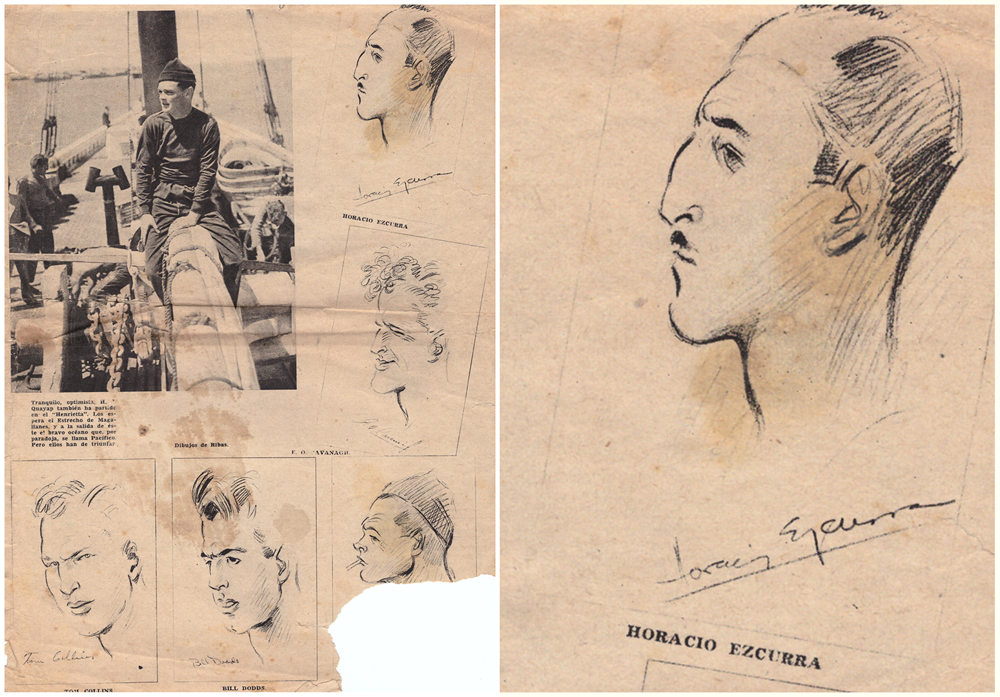

El viaje está muy documentado a través de cartas que le escribía uno de los tripulantes, Marvin Collins, a su padre en Estados Unidos, quien las publicaba en el diario _Spirit Lake Beacon_: "estamos sumando tres argentinos a nuestra tripulación, ya que necesitamos mucha fuerza para los vientos en el Estrecho. Todavía no los conocemos muy bien, pero parecen buenos muchachos" [@collinsSailingSevenSeas1938].

Mi tío Exequiel Ezcurra fue quien llevó a cabo la mayor parte de la investigación sobre el viaje, inspirado por el hallazgo de mi primo Joaquín Ezcurra que encontró en 2012 la cinta en VHS de la película, la digitalizó y la envió por email a la familia. Toda la información del viaje parte de su documentación, publicada en su blog: "Después de que Joaquín Ezcurra nos enviara la versión digital de la película de Horacio Ezcurra –El Yayo– con su fascinante viaje alrededor del continente en la goleta Henrietta, me puse a buscar en las hemerotecas de la época a ver si encontraba alguna pista periodística del viaje"[^3] [@ezcurraRutaHenriettaSiguiendo2012].


Mi abuelo Horacio tuvo la oportunidad de documentar el viaje con una cámara de 16 mm, posiblemente prestada. En el increíble material pueden verse imágenes de Mar del Plata, Mar Argentino, el Estrecho de Magallanes, glaciares, barcos petroleros, nativos Kawésqar, Valparaíso y Los Andes. También la relación entre ellos en el viaje, que eran 12 tripulantes: 7 norteamericanos, 2 británicos y 3 argentinos.

_Henrietta_ partió de una obsesión personal con la fotografía analógica y también por una curiosidad natural de estudiante de cine por trabajar con material fílmico, cosa que para mi generación y al menos para la Universidad de Buenos Aires era un poco lejana. Para el 2014 estaba muy inspirado por el cine de Werner Herzog, de tono documental, filmado en exteriores, de personajes masculinos aventureros en paisajes inhóspitos. Desde un punto de vista técnico estaba interesado en el fílmico por una idealización que tenía de la resolución potencialmente infinita de la película analógica (por no tratarse de valores discretos de píxeles). Ese año había visto en el festival BAFICI una restauración en 4K de _La Épica del Everest_, de John Noel, y me fascinó poder ver esas imágenes del pasado en una resolución tan alta, con los planos del Everest entintados en azul. Fue la primera vez que vi cine de principio de siglo en alta resolución.

Me puse en contacto con mi familia para localizar el material original, y se encontró que estaba guardado en la casa en San Luis donde supieron vivir mis abuelos en sus últimos años. Cuando dí con el material, me encontré con una gran decepción. La película desprendía un olor muy fuerte a vinagre y el material estaba endurecido y resquebrajado. Era muy difícil apreciar las imágenes porque parecía como si la emulsión se hubiera separado del soporte. Descubrí así el famoso "Síndrome del Vinagre", un proceso de deterioro que actúa en películas de acetato de celulosa cuando son expuestas a condiciones adversas de humedad y calor. La película libera ácido acético, el responsable de su particular olor a vinagre y del deterioro de la película. Según las guías de almacenamiento de películas de acetato de la revista _Topics in Photographic Preservation_ del _Image Permanence Institute (IPI)_, todas las películas de acetato son susceptibles a este deterioro. Es un proceso irreversible que se acelera de película a película a través del aire, y que ocurra depende principalmente de las condiciones de almacenamiento en las que se mantenga la película. Según los autores una lata típica de 1000 pies de película avinagrada puede llegar a contener el equivalente de hasta 250 cucharadas de vinagre de mesa [@reillyIPIStorageGuide1993].

Según las guías del IPI el síndrome del vinagre se caracteriza por ser un proceso "autocatalítico" en el que aumenta la acidez en la base del soporte plástico. El artículo explica que un catalizador es simplemente una sustancia que no se consume en una reacción, pero que hace que la reacción sea mucho más rápida. El síndrome del vinagre es autocatalítico porque genera su propio catalizador: una unidad de ácido entra en la reacción y salen dos, dos ácidos entran en dos reacciones y salen cuatro, lo que resulta en una tasa de deterioro inicial lenta seguida de un aumento rápido en las etapas posteriores. Afortunadamente, este comportamiento depende mucho de las circunstancias de almacenamiento. Los materiales guardados en buenas condiciones en la primera parte de sus vidas tienden a durar más. Además, las películas en condiciones ventiladas generalmente se degradan más lentamente que las películas selladas herméticamente porque esto permite que el catalizador de ácido acético escape de la lata [@nishimuraIPIStorageGuide1993].

La película estaba encogida y arrugada, era imposible de reproducir en un proyector convencional e imposible de enviar a digitalizar profesionalmente como había imaginado en un comienzo, por lo que recurrí a métodos no convencionales. En internet encontré el método de un alemán llamado W. Kurz que digitalizaba sus películas en 16 mm con un escáner Epson V700 y una serie de motores[^4]. Inspirado en este trabajo compré el mismo escáner pero por el estado de la película tuve que hacer el arrastre y la digitalización de forma manual, cuadro por cuadro.

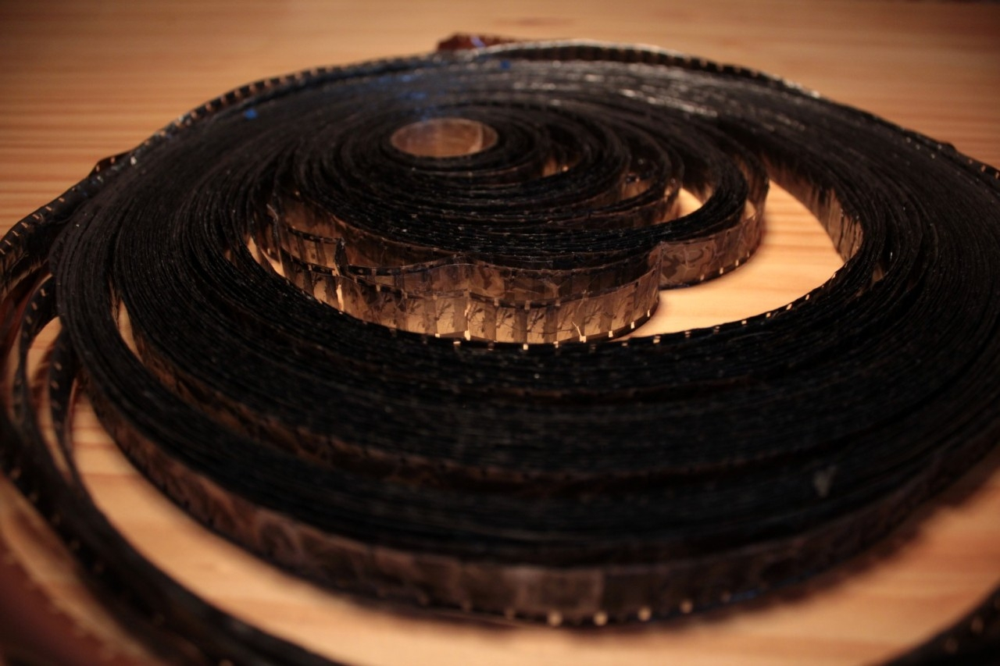

Esta primera etapa tomó varios meses y fueron días de mucha repetición y concentración. Por cada captura se digitalizaban 9 fotogramas a la vez, de un total de casi 20.000. El trabajo consistía en posicionar, escanear, recortar, compilar, estabilizar y renderizar. Diseñé un sistema en el que digitalizaba cada tira, con Photoshop individualizaba los fotogramas en orden a través de una grilla, compilaba nuevamente la animación en After Effects, estabilizaba el movimiento y exportaba el video.  Cada tanto podía mirar un poco el resultado y descubrir detalles y cosas nuevas (porque ya conocíamos la película en su versión VHS). Por la fragilidad, cada tira de película que retiraba del rollo quedaba desprendida del resto.

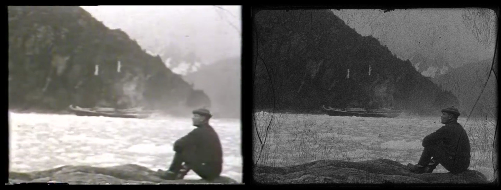

El proyecto aquí se transformó en otra cosa: pasé de la obsesión por la “alta resolución” a una búsqueda estética basada en la degradación, la oscuridad y el efecto óptico del material, del cual podemos encontrar un estilo semejante a las películas del realizador experimental Bill Morrison. Pero además surgió casi accidentalmente una responsabilidad ética de rescatar por última vez este material de la destrucción total.

Luego de digitalizar la totalidad del material, en la siguiente fase de creación diseñé con la computadora un espacio virtual y bidimensional parecido a un "dominó", conectando planos por su morfología y continuidad espacial. Cada plano estaba _loopeado_ como si fuera un GIF, lo que me permitía explorar este espacio sin prestar mucha atención a la sincronía o el tiempo. Este espacio bidimensional era recorrido por una cámara virtual, que entraba y salía de los distintos escenarios. Por momentos también hacía un montaje convencional, pero esta idea fue la principal a la hora de explorar las imágenes. Esto iba en contra de la dirección natural de una película en fílmico, que es vertical, y me gustaba la idea de evidenciar el dispositivo, el fílmico, las perforaciones y las marcas de la cámara.


Los textos de _El Gráfico_ y el _Spirit Lake Beacon_ fueron incorporados al trabajo de forma gráfica y sirvieron como separadores entre escenas. La banda sonora fue compuesta por el músico argentino Ariel Schlichter. 

Luego de terminado el montaje se pasó a la siguiente fase de videoinstalación. Por sugerencia de mi profesor Mariano Ramis, diseñamos una pantalla de tela no tensada, suelta, que era flameada por unos ventiladores a los laterales del marco de la pantalla. La idea era imitar el movimiento que se generaba en las imágenes. También se le agregó un switch automático que encendía y apagaba los ventiladores cada unos segundos para generar irregularidad en el movimiento.

A finales del año 2014 _Henrietta_ se mostró en la muestra anual de diseño en el Centro Hipermediático Experimental Latino Americano (cheLA), junto a otros trabajos de la cátedra. El proyecto fue muy grato, fueron muchos meses de trabajo y más adelante llegó a ganar algunos premios y reconocimientos[^5]. El material en crudo fue incluso proyectado en el Museo Malba de Buenos Aires en el marco del Orphan Films Symposium, invitado por Andrés Levinson. Además me acercó al Museo del Cine de Buenos Aires a través de Carolina Cappa, investigadora de la institución y directora de esta tesis, donde comencé a trabajar como ayudante en la cineteca. En el museo en determinado momento también pusimos en práctica el mismo método de digitalización que había usado en _Henrietta_ para digitalizar distintos materiales. El mismo sistema se utilizó para digitalizar los fotogramas del libro _Nitrato argentino, una historia del cine de los primeros tiempos_, editado por Carolina Cappa y el museo. Este sistema de digitalización y conservación del 2014 me acompañó hasta el día de hoy y es, en una versión más nueva, una de las herramientas de experimentación que se usan en la tesis.

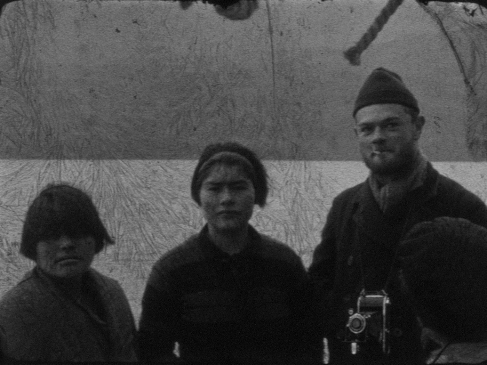

## Cuanto más se conecta, menos se conecta (2019)

Como en mi familia no había filmadora cuando era chico, no tengo muchas imágenes en video de mi infancia. El único material audiovisual que conozco de esa época es un cassette que grabó un tío en una de sus visitas por Bariloche. Ese video, junto a otro producido en mi jardín de infantes, y el proyector de diapositivas de mi papá, eran las experiencias más cercanas que tuve de acercamiento a la creación audiovisual, y me marcaron mucho. Empecé a entender que existían las películas, y también otro tipo de películas, en las que uno podía participar. Este material cobró interés 25 años después en Nueva York.

Como se mencionó antes, _Cuanto más se conecta, menos se conecta_ fue realizada en contexto de una residencia de tres meses en la _School for Poetic Computation_ en Nueva York. Esta escuela, que sigue hasta el día de hoy, es una institución de enseñanza de electrónica e informática con un enfoque crítico y poético, fundada por Zach Lieberman y Taeyoon Choi en 2013. La residencia en 2019 se realizó en un espacio del edificio Westbeth, en el Far West Village de Manhattan. Originalmente este lugar había sido construido como un complejo de 13 edificios en 1868 para Western Electric. En 1898, Bell Laboratories lo compró y lo convirtió en uno de los centros de investigación más importantes del mundo. Fue aquí donde se proyectó la primera película sonora, se inventó el micrófono de condensador, se llevó a cabo la primera transmisión de televisión y se diseñó la primera computadora binaria. En 1966, Bell Labs se trasladó fuera de Manhattan. A partir de 1970 comenzó a funcionar como un edificio para hospedar artistas y familias de artistas[^6]. En un espacio de este edificio es que se llevó a cabo la cursada, que se dividió en cuatro materias, dictadas por diferentes profesores, y se nos permitió utilizar el espacio para desarrollar un proyecto final. 

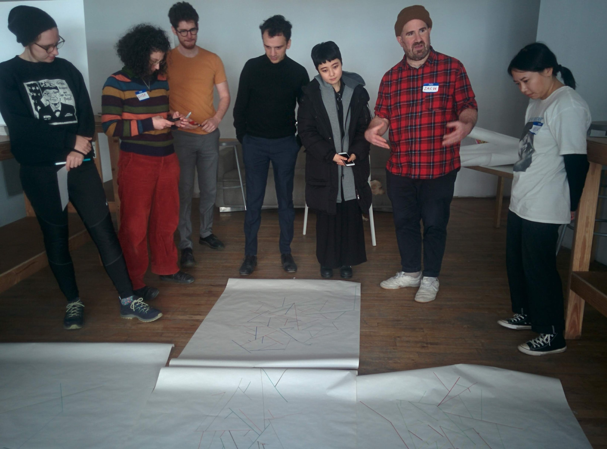

Después de aproximadamente 2 meses de cursada había llegado el momento de desarrollar el trabajo para la exposición final. Interesado en trabajar con material de archivo, yo tenía digitalizado el video de mi infancia antes mencionado y se me ocurrió partir de ese material.

En primer lugar, en la cursada había desarrollado un programa en Python que con una librería llamada _Moviepy_ desordenaba los fotogramas de un video de una forma determinada: al primero le seguía el último, al segundo el penúltimo, al tercero el antepenúltimo, y así. Si un video era una sucesión de imágenes A-B-C-D-E-F-G, el programa devolvía un video con siguiente orden: A-G-B-F-C-E-D[^7]. Este primer acercamiento demostró ser un muy buen ejemplo de la tecnología del código para editar video, cosa que no había hecho nunca programáticamente. Al aplicar el algoritmo de edición a la película de mi infancia se generó una yuxtaposición de caras y recuerdos muy simbólica e inspiradora, en la que se chocaban generaciones, espacios y sonidos, y la alternancia de imágenes generaba un efecto muy hipnótico en el ojo, al mejor estilo de cine expandido[^8].

En una materia habíamos estudiado librerías de detección de rostros con inteligencia artificial. Con ella uno podía detectar caras en una imagen y reemplazarlas o recortarlas en tiempo real, a través de una cámara o un video. Esto me llevó a experimentar con el material en video y experimentar con las caras de la familia y generar una especie de collage digital.

Más adelante llegó el momento de combinar todas estas tecnologías, y viendo los recursos disponibles en la escuela conseguí dos monitores de PC sin carcaza, con el marco de aluminio expuesto, a los que les incorporé un panel de aluminio con conectores banana hembra.

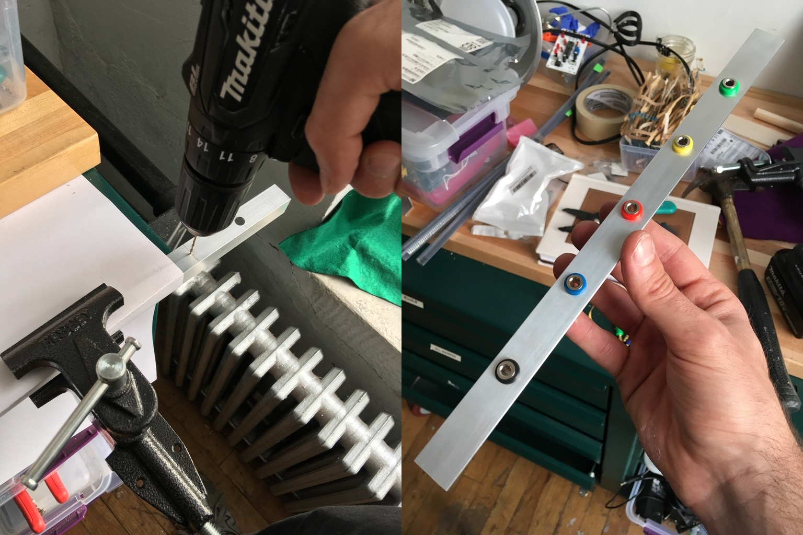

Como se explicó anteriormente, los paneles de aluminio adaptados a sus lados conectaban un monitor con el otro a través de cables banana monopolares. Las distintas combinaciones de cables eran traducidas a digital por un módulo _Arduino_ e interpretadas en una computadora por un programa escrito en _openFrameworks_. Este programa tenía precargados todos los videos, y se iban acumulando en capas de acuerdo al orden de los cables. Desde el punto de vista del espectador, en el monitor izquierdo se podía ver el material sin editar en crudo. En el monitor derecho, la pantalla en negro. Cuando se conectaba un cable de la izquierda a la derecha se generaban distintos resultados en este monitor derecho, que consistían en combinaciones de caras de personajes de la familia recortadas por un algoritmo de reconocimiento facial, y algoritmos de edición que desordenaban los fotogramas del video original. El resultado a la derecha era un collage desordenado y caótico de caras, escenarios y sonidos.

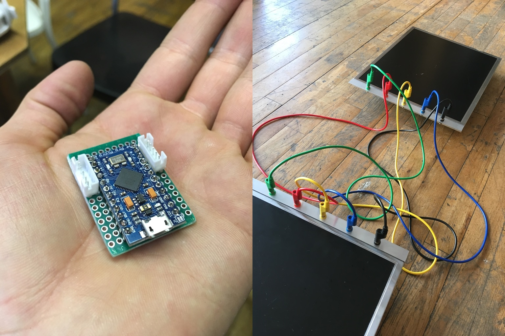

_Cuanto más se conecta, menos se conecta_ vino a concluir y representar un poco lo aprendido en la cursada. La pantalla de la izquierda era una representación del pasado inalterado, y la pantalla de la derecha aludía a la forma en que tendemos a recordar las cosas: fragmentadas, rotas, en detalles, reconstruidas. Fue un ejercicio de nostalgia y memoria, que contrasta tecnologías analógicas con digitales, confrontando el video de baja resolución con la detección de rostros, los filtros, la inteligencia artificial y los algoritmos automáticos.

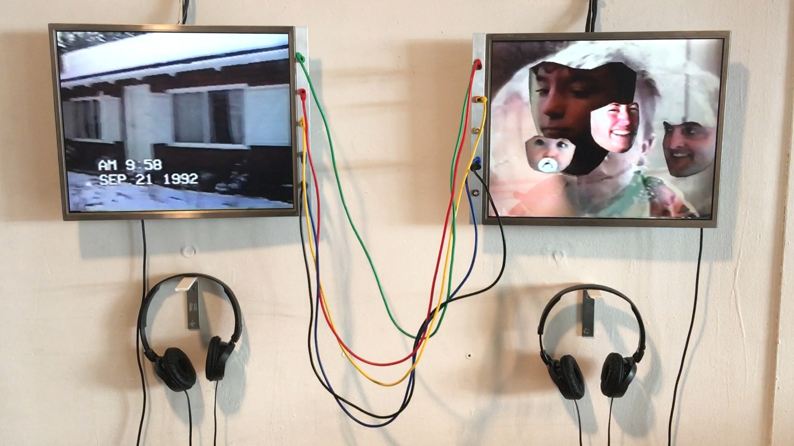

# II. A medio camino entre el arte y la preservación

¿Por qué se preserva? ¿Cómo se guardan las películas? ¿Qué tienen en común con el arte por computadora? ¿Cómo hacen los museos para salvar videos, páginas web, obras de arte electrónico y videojuegos en tiempos de velocidad tecnológica y obsolescencia electrónica? En este segundo capítulo vamos a estudiar algunas formas de preservación de los "Time-based Media" y vamos a analizar el trabajo de algunos referentes artísticos y técnicos del mundo del cine experimental, el arte por computadora, el arte electrónico y los archivos de internet.

Del latín _praeservare_ ("cuidar/observar con antelación"), preservar podría definirse como proteger anticipadamente alguna cosa frente a accidentes, acciones humanas o el paso del tiempo. Preservar implica pensar estrategias para desafiar el paso del tiempo y desarrollar un juicio de valor para decidir el criterio con el que se preserva. En este primer apartado vamos a contextualizar de forma general la acción de preservar y vincular sus particularidades y contradicciones con el mundo de la preservación de obras cinematográficas.

## Contradicciones e impurezas

¿Por qué preservamos? La investigadora argentina Mariela Cantú plantea que "una de las más fascinantes e imperecederas fantasías humanas (aún hoy, a pesar de todas nuestras derrotas) radica en la creencia de un mundo que puede ser ordenado, clasificado y así, en última instancia, dominado. (...) Es aquí donde el archivo se hace presente, en la medida en que su concepto (y su labor) proponen un ordenamiento, un discurso y, en última instancia, una forma de contacto con el pasado y con las posibles memorias que pueden generarse a partir de él" [@cantuArchivosVideoNo2015].

El historiador norteamericano David Lowenthal explica algunos de los orígenes de la "manía por la memorabilia" de la humanidad en su artículo _Material Preservation and Its Alternatives_. En primer lugar plantea los orígenes de la preservación en la búsqueda humana por sus raíces desde un aspecto nostálgico y genealógico: la tradición oral, el romanticismo por la historia, las expectativas y la decepción con el presente. En este contexto, también destaca como orígenes la difusión del nacionalismo, que preserva íconos de identidad, y el capitalismo, que preserva símbolos de poder. Y en segundo lugar plantea lo obvio: la memoria es trunca y da origen a herramientas de preservación como aniversarios, archivos y museos [@lowenthalMaterialPreservationIts1989, p. 68].

El autor enumera de manera general un par de motivos de la preservación en forma de "cultos". Primero habla del "culto a lo representativo" como el mérito a aquello que representa "algo de un tiempo determinado". Después plantea el "culto al folklore" por el valor de los pueblos que no dejaron palabra escrita. El "culto a lo familiar y reciente" como una lucha contra la obsolescencia y la dislocación. Y el "culto a lo económico" por la explotación energética, turística o de materiales [@lowenthalMaterialPreservationIts1989, p. 68].

Lowenthal también explica los criterios y contradicciones de preservar patrimonio histórico a través del dilema de "El Barco de Teseo" de Plutarco. Amarrado en el muelle de un astillero por reparaciones, todas las viejas tablas del barco son reemplazadas por unas nuevas. ¿Es todavía el barco original? Según el autor es difícil separar la "identidad" de la "colección", lo más importante son las propiedades genéticas: el creador, el período, y la historia. Por otro lado, Lowenthal también plantea que preservar conlleva contradicciones en la sociedad: los "costos" contra el progreso de la modernidad, la preservación contra la creatividad, y el divorcio con la realidad de todos los días [@lowenthalMaterialPreservationIts1989, p. 69 - 71].

Lowenthal además propone que preservar es más que la persistencia física de algo y lo ejemplifica a través de algunas alternativas. Primero habla de la "fragmentación", preservar una parte y no el todo, lo que trae ventajas espaciales y simbólicas. Luego habla de preservar con "procesos", la destrucción inherente a la preservación como parte de una reconstrucción (y cita el ejemplo del templo de madera Ise Shinto en Japón que en los últimos mil años se viene desarmando y rearmando completamente cada 20 años). Y finalmente habla de preservar con "el lenguaje y las ideas", la memoria contra la persistencia física, como la china de Mao cuando se mandó demoler monumentos históricos para dar paso a nuevas ideas y nuevo arte, donde las posesiones materiales son vistas como vicios que dan lugar a la lujuria de la acumulación [@lowenthalMaterialPreservationIts1989, p. 74]. Lowenthal acompaña esta idea de que si bien preservar es innato a la vida, no lo es más que innovar: "Preservar no es la acción ni el epílogo; es solamente el prólogo" [@lowenthalMaterialPreservationIts1989, p. 76].

Para Lowenthal preservar es un acto creativo, innovador, contradictorio e innato en el ser humano, y muchas decisiones se toman en relación al momento histórico, el contexto, los recursos y el patrimonio en sí. Vamos a ver los desafíos de preservar películas.

## Una obligación inestable

En el prólogo al libro _Clasificar para Preservar_ del investigador español en cine Alfonso del Amo García plantea la “obligación incuestionable” de las civilizaciones de “preservar la memoria y la historia”. El texto asevera que “mediante la palabra repetida y atesorada en piedra, pergamino y papel, sabemos quiénes somos y cuál es nuestro lugar en el mundo”. Considerando las diferentes realidades socio económicas e históricas de los archivos del mundo, el autor presenta el libro como una especie de guía y manifiesto y no como un “manual de preservación”. Del Amo García explica que los archivos se mueven en un amplio abanico de circunstancias económicas y técnicas, en general muy precarias, y que pocos archivos disponen del personal y los recursos necesarios y casi ninguno puede garantizar el mantenimiento indefinido de las condiciones de conservación, y que además, todos los archivos están sometidos a presiones para que centren sus posibilidades económicas en “lo digital” [@amogarciaClasificarParaPreservar2008].

Además de resaltar la importancia del compartir y el acceso a las películas, el autor prioriza la clasificación en los archivos y el conocimiento técnico de los materiales como fuente de poder frente a la acción implacable del tiempo. Si bien este conocimiento técnico fue a la par del desarrollo de las tecnologías fílmicas, hay que pensar que la mayoría de las precauciones y clasificaciones de los manuales y métodos actuales se estudiaron muy posteriormente a las incontables pruebas y errores de las distintas compañías que producían material fotográfico a lo largo de los siglos XIX y XX. De la era del cine silente en Estados Unidos se estima que al menos el 70% de las películas están completamente perdidas [@pierceSurvivalAmericanSilent2013, p.136], y esto es principalmente por la volatilidad del soporte de Nitrato del que estaban hechas las películas antes de la comercialización de la película en acetato en las primeras décadas del siglo XX.

Como anécdota de esa prueba y error, es interesante citar una curiosa historia de la biografía del fundador de Kodak, George Eastman, de Elizabeth Brayer, donde se describe una gran crisis por la que pasó la compañía en sus primeros años de vida a finales del siglo XIX y que según la leyenda fue determinante para el futuro de la fotografía y el cine. En sus primeros tiempos, Kodak se dedicaba principalmente a la venta de placas con bromuro de plata para cámaras fotográficas, y a principios de 1882 comenzó a recibir quejas de clientes que comentaban que las placas que estaban comprando estaban registrando imágenes muy "nubladas", o directamente ninguna imagen. Preocupado por esta situación, Eastman decidió cerrar la fábrica temporalmente para investigar el problema, siendo que las placas vendidas en los primeros dos años habían funcionado muy bien. Después de "469 experimentos fallidos para resolver la crisis" decidió viajar a Inglaterra para encontrarse con sus proveedores de químicos y materiales, donde después de unos días de investigación descubrió que se habían cambiado los animales que se usaban para la gelatina de la emulsión. Creyendo que se trataba de algún tipo de impureza en el nuevo ganado, al exigir que se volviera a la materia prima original, el problema fue solucionado, y Kodak recuperó su producción en muy pocos meses. Pero no fue hasta 40 años después que en los laboratorios de investigación de la empresa el Dr. Kenneth Mees descubrió que la presencia de azufre en la emulsión fotosensible tenía el poder de aumentar la sensibilidad en las películas, y llegó a la conclusión de que el origen del problema en aquel entonces había sido que los terneros pastaban en campos ricos en plantas de mostaza salvaje, que contienen azufre, y los terneros a los que los proveedores habían cambiado no contaban con esta planta en sus pasturas, lo que resultó en un material fotosensible defectuoso [@brayerGeorgeEastmanBiography1996, p. 41]. Por la velocidad de exposición que necesita cada fotograma en una película, algunos creen que gracias a las plantas de mostaza existe el cine tal como lo conocemos: "si a las vacas no les gustara la mostaza, no existirían las películas" [@meesHistorySensitisers1945].

La idea principal del libro de Amo García es la documentación: la mayor cantidad posible. En la introducción se plantea que "la clasificación de los materiales que se tienen que preservar es una actividad básica para cualquier tipo de archivo y, además, es la actividad sobre la que puede fundamentarse la implantación de políticas de preservación" [@amogarciaClasificarParaPreservar2008, p. 2]. Por otro lado el autor destaca que "la conservación de los originales, en las mejores condiciones funcionales y durante todo el tiempo que sea posible, es la única política que puede asegurar la supervivencia del patrimonio cultural cinematográfico". Y finalmente hace especial hincapié en la importancia de "reproducir para preservar", una actividad básica en archivos cinematográficos, que presenta muchas dificultades y discusiones pero que nos abre las puertas a las ideas de acceso que trataremos más adelante.

En el libro _From Grain to Pixel: The Archival Life of Film in Transition_ la archivista Giovana Fossati aumenta la apuesta y suma a la discusión el papel de lo digital en la preservación cinematográfica. La autora define al cine como una transición, como una continua transformación de los medios audiovisuales. Este momento transicional que define la autora se basa en su cualidad híbrida analógico-digital, en su momento histórico donde si bien lo digital ya forma parte del estándar industrial, lo analógico sigue siendo relevante en producción y en distribución. Lo analógico en la práctica también funciona como base teórica y metafórica, pues las cámaras, los proyectores y hasta los procesos en el flujo de trabajo industrial son todas herencias de sus parientes analógicos (por ejemplo, la señal digital vs los fotogramas por segundo, la apertura del obturador vs la tasa de refresco de un sensor digital, etc.). Es en este "momento transicional" [@fossatiGrainPixelArchival2018, p. 22] que se para el archivista hoy y es importante apreciar y estudiar la hibridez de lo analógico y lo digital para entender esta transición en los archivos y la preservación.

Cantú plantea "tres niveles de preservación de la memoria audiovisual: el del deseo de conservar el mundo a través de las imágenes; el de conservar las propias imágenes, en tanto también son estas objetos materiales sometidos al desgaste y por ende, a la desaparición; y el del cuidado hacia los propios archivos que procuran evitar que esas imágenes caigan en el deterioro y la muerte" [@cantuArchivosVideoNo2015].

Las películas implican un desafío particular de preservación. Presentes en las sociedades desde hace poco más de 100 años, ocupan mucho lugar, se descomponen, se pudren. Necesitan temperaturas y humedad controladas. El material de nitrato de la mayoría de las copias del período de cine mudo es inflamable, y el material de acetato se avinagra en ácido acético con facilidad. Las copias se encogen, se endurecen. No es un material fácil, aunque al mismo tiempo es un sistema genial y elemental: a diferencia de sistemas digitales o magnéticos donde hay que decodificar la señal, lo único que requiere una película para apreciarse con el ojo humano es luz a través de su soporte. Esto trae ventajas importantes frente a la preservación de otros medios como los "born-digital" o los basados en tiempo que veremos más adelante. Sin embargo, con respecto a esta ventaja, Fossati explica que los conceptos de analógico y digital no ayudan mucho a distinguir entre los medios que son comprensibles para nosotros y aquellos que necesitan ser decodificados para la comprensión. La fotografía y el cine analógicos son una singularidad tecnológica que es el único sistema de representación completamente libre de codificación e isomorfo con la imagen original, ya que las imágenes fotográficas se transcriben y almacenan de una manera que es comprensible para nosotros sin ningún tipo de proceso de decodificación (a menos que consideremos el desarrollo químico de la imagen latente de una fotografía como un proceso de decodificación en sí mismo) [@fossatiGrainPixelArchival2018, p.26].

En relación a esto, es importante hacer una pequeña mención del formato de video. Las cintas magnéticas transportan información en forma de señales eléctricas, codificadas de forma magnética a través de materiales metálicos ordenados sobre el soporte. Cualquier tipo de información que transporten, sea digital o analógica, necesita ser decodificada antes de ser utilizada, por lo que esta particularidad hace del video un sistema que requiere muchísimo mantenimiento y actualización de los dispositivos encargados de reproducirlos. Su utilización en video fue deprecada en los últimos años por sistemas más rápidos como la tarjetas de memoria o los discos rígidos, pero el soporte sigue existiendo, los LTO (Linear-Tape Open), por ejemplo, son sistemas de guardado digital en cinta magnética de capacidades de hasta 18 TB en su última generación. Cada generación requiere de su reproductor indicado, por lo cual el archivado en este tipo de tecnología consume muchísima logística para la mudanza y la actualización.

Por esto hoy el cine digital está viviendo una tragedia archivística reminiscente a las de la época del celuloide. Hay una idea errónea de que los archivos digitales son seguros para siempre. Los archivos terminan corrompiéndose, los datos se transfieren incorrectamente, los discos duros fallan, los formatos cambian y el trabajo simplemente desaparece. "Es un incendio silencioso", como mencionan Gary Baum y Carolyn Giardina en un artículo del Hollywood Reporter (traducido del inglés):"El temor es que, al igual que muchas películas mudas y películas de mediados del siglo pasado se han perdido debido a políticas de archivo inadecuadas, los archivos digitales contemporáneos podrían sufrir un destino similar" [@baumItSilentFire2024].

Con el video magnético no es diferente, y a la migración se le suman también la multiplicidad de formatos. Mariela Cantú explica que "es difícil pensar al video por fuera de la multiplicidad de sus formatos (cintas de 2 pulgadas, de 1 pulgada, Betamax, U-Matic, VHS, Hi-8, Betacam, mini DV, DVCAM, Betacam digital o Digi Beta, D I, D II o el CG, el DVD, la HDD, etc.), así como de la necesaria mudanza de soportes para asegurar su supervivencia" [@cantuArchivosVideoNo2015].

El video cuenta con otra particularidad: el "original" suele ser un componente ambiguo en la cadena de preservación, a diferencia de la escultura o la pintura, o los negativos de cámara de una película. Muchas veces son pasos siguientes a un original, o se trata de una generación del material de algo en otro formato (fílmico, digital, etc). Cantú suma que "muchas veces, antes incluso de alcanzar la desaparición material que ataca al cine fotoquímico, el video migra de soporte. Signados por un presente en el que la hibridez constituye una constante en la creación audiovisual, sería posible inscribir a cada uno de esos soportes como marca de una época, casi como signo de los cambios físicos que se revelan con cada edad en el propio cuerpo [@cantuHistoriaImagenesArchivo2012].

## La restauración cinematográfica y el concepto del original

En el libro _Restoration of Motion Picture Film_ de Read y Meyer se define al original como el material capturado directa y exactamente desde la cámara. El negativo de cámara es el original y los "prints" son las copias para ver el material [@readRestorationMotionPicture2000, p. 14]. Y si en el cine analógico resulta intuitivo imaginar cuál es el material original, en el cine digital la definición tiende a complicarse. 

En su libro Fossati habla del "original" como el núcleo de la práctica archivística, pero lo define como un punto de discusión entre la naturaleza conceptual y material del medio. Y el original es, en definitiva, protagonista del conflicto de la preservación que venimos definiendo hasta ahora. La autora defiende que el significado de "original" puede cambiar según los marcos teóricos que uno adopte. "Lo original" puede ser un artefacto conceptual (por ejemplo, una versión particular de una película) o un artefacto material (por ejemplo, el negativo original de la cámara), puede referirse a la película tal como se mostró originalmente al público, así como al artefacto material cinematográfico tal como fue recuperado por el archivo cinematográfico. Pero puede referirse a la película como texto, donde su integridad se mide en términos de completitud y continuidad (por ejemplo, todas las escenas que constituyen la versión tal como fue concebida por el director, editadas en su orden correcto), o a la película como texto y como artefacto tecnológico, donde la resolución, la profundidad de color y el aspecto en general también son partes integrales del conjunto [@fossatiGrainPixelArchival2018, p. 161].

Sería pertinente diferenciar preservación de "acceso". Como habíamos dicho, preservar patrimonio cultural consiste principalmente en conservar su forma original frente a las adversidades del paso del tiempo, o frente a accidentes o acciones humanas; y muchas veces consiste también en “restaurarlo” (o volverlo) a esa forma. “Dar acceso” a una obra,  a nivel público, consiste en democratizar su visualización y utilidad. Y podría considerarse la antítesis de la idea de preservación, pues a nivel abstracto puede sugerir degradación y desgaste, aunque muchas veces demuestran ser inesperados salvadores del patrimonio.

Ya Walter Benjamin en _La obra de arte en la época de su reproductibilidad técnica_ planteaba una polaridad en las obras de arte, basada en el valor de culto por un lado y el valor de exhibición por el otro. La producción artística nace al servicio de los rituales: la apreciación humana era casi accidental y lo que realmente importaba era que sea presenciada por dioses y espíritus. A medida que en la historia se fue emancipando el ritual del proceso artístico, el potencial de exhibición fue aumentando, para llegar hoy al énfasis exclusivo puesto en este valor [@benjaminWorkArtAge2008, p. 25].

Como se mencionó antes, Del Amo García destacaba la clasificación de los materiales, la conservación de los originales y la "reproducción para la preservación". Este último punto es importante, porque Fossati menciona que la diferencia principal entre los archivos y los museos o cinematecas es que los primeros tienden a no tener como misión principal el acceso al material (la reproducción), mientras que los otros sí. La principal diferencia entre archivos, museos y cinematecas radica en la forma en que exhiben sus películas, de acuerdo con la declaración de su misión, o política de exhibición [@fossatiGrainPixelArchival2018, p. 31]. Sin embrgo, la polémica de exhibir el fílmico original frente a las posibilidades de lo digital sigue existiendo en cinematecas y archivos de todo el mundo, porque a pesar de que indefectiblemente una película puede sufrir accidentes en cada nueva reproducción, nos encontramos también en un debate simbólico de "lenguaje e ideas" como decía Lowenthal: si el propósito de preservar es mantener una obra lo más fiel posible a su versión original, ¿no debería también tenerse en cuenta el propósito principal de las copias de exhibición? ¿Qué sucede cuando no es posible una digitalización por razones económicas o técnias y la exhibición en fílmico da lugar a un nuevo espacio de desarrollo cultural y educativo en las comunidades, o incluso multiplica las posibilidades de difusión de la obra?

El concepto de la "conservación de los originales" que menciona del Amo García parece obvia, pero no es así de manera universal. En el ámbito cinematográfico la duplicación fílmica (la copia de películas) sirve tanto para producir copias de acceso al material como para generar nuevas copias de archivo. En Argentina es conocido el caso de la colección de películas de Manuel Peña Rodriguez, actualmente conservadas en el Museo del Cine Pablo Ducrós Hicken de Buenos Aires. En el libro _Nitrato argentino, una historia del cine de los primeros tiempos_, Leandro Varela cuenta la historia de Peña Rodriguez, un crítico, productor y realizador de cine Argentino que en 1941 fundó el Primer Museo Cinematográfico Argentino (PMCA) y cuya colección pasó a estar bajo custodia del Fondo Nacional de las Artes a finales de los años 60 por una deuda que tenía el crítico con la institución. La colección contaba con importantes obras del período silente en su formato original de 35 mm en soporte nitrato, algunas de las cuales hoy se consideraban perdidas. El estatuto del PMCA hacía mención a la posibilidad de reducir películas "con el objeto de facilitar su conservación, distribución y manejo" [@penaMetropolis2011, p. 136] y hacia 1971 se dispuso la destrucción de las copias originales luego de reducirlas a 16 mm en soporte acetato, con intenciones de dar acceso pero también de salvarlas de su pronta degradación total, pues era lo que se solía hacer en esos tiempos con el material en soporte nitrato, que entre otras cosas era inflamable y el acetato era más económico y seguro ("Safety Film"). A esto se le sumó en 1974 una transmisión televisiva de estos cortos del período silente transmitida por Canal 7, en el que sin ningún criterio de preservación se cortaban y editaban nuevas versiones adaptadas para los tiempos televisivos. Los efectos fueron devastadores para la colección: las películas perdieron color, detalle, e incluso coherencia narrativa. Sin embargo, son también las únicas copias existentes de algunas películas que se consideraban perdidas a nivel internacional[^9]. La llegada de la película con soporte de acetato fue de gran impacto en el ámbito de la preservación ya que este nuevo soporte poco inflamable y químicamente estable permitiría generar copias de preservación a largo plazo, aunque al final el soporte resultó ser "altamente susceptible a la descomposición, sobre todo cuando se encuentra conservado en ambientes cálidos y húmedos. Al descomponerse, el soporte comienza a producir ácido acético y emite un olor similar al del vinagre. Es por esto que se suele denominar a esta forma de descomposición fílmica "síndrome de vinagre" [@varelaTestimoniosNitratoReduccion2019].

La colección de Manuel Peña Rodriguez es una surgida de los márgenes, sin cuidado y legitimización institucional, que finalmente terminan siendo indispensables para el patrimonio audiovisual institucional. Casos parecidos a este son los de Henri Langlois y la Cinemateca Francesa, o la colección de películas efímeras del coleccionista amateur Rick Prelinger, parte de la cual hoy custodia la Library of Congress en Estados Unidos, y de la que sus títulos están disponibles en el Internet Archive.

En restauración digital para cine, la idea general de preservación muchas veces depende del interés del cliente que paga por el trabajo. La idea de “conservar” la forma original muchas veces es olvidada y reemplazada por una idea de que se vea “mejor” (e incluso cuando esto implica modificar limitaciones tecnológicas de la época: corregir fluctuaciones de luz, simular fotogramas faltantes, estabilizar la cámara, simular color, etc.).

Estos dilemas también escapan de los laboratorios de restauración más profesionales: en Youtube hay decenas de canales dedicados al rescate y la preservación de películas del cine mudo, con herramientas de Inteligencia Artificial, que le suman color, resolución, estabilización y fotogramas. “Nineteenth century videos back to life” promete uno de los canales más famosos, con sus _upscalings_[^10] a 4K y conversión digital a 60 fotogramas por segundo. A pesar de la polémica, la aparición de la IA en películas históricas de Youtube resulta ser también un tipo de hibridez transicional como las que venimos observando. La diferencia entre la última tecnología de un laboratorio europeo que restaura películas y estos usuarios de Youtube que "restauran videos del siglo 19" da para debate (técnicamente ni siquiera son "videos", o al menos no en su forma original). En primer lugar pareciera haber un abismo entre los conceptos de "originales" de ambas partes. En segundo lugar, mientras unos buscan la conservación del original, otros parecieran buscar verosimilitud, realismo, asombro y colores. La problemática sobre que es el original en el cine continúa siendo parte de un eterno debate. ¿Acaso las roturas, la velocidad de los fotogramas, la inestabilidad e la proyección, la inexactitud de la cámara, no son parte de un original? Los reestrenos de la trilogía original de Star Wars de George Lucas, quien apostó incondicionalmente al digital y en sus sucesivas nuevas versiones fue mejorando planos y tomas de las primeras películas, ¿son más o menos originales?

## El artista como preservador accidental

La directora e investigadora de cine experimental Sharon Sandusky opina que "la recuperación de una película es frecuentemente un proceso accidental", y que "la creación o la destrucción de imágenes y sonidos está enteramente conducida por intereses económicos" [@sanduskyArchaeologyRedemptionArchival1992]. La tesis de la autora apunta a que para los grandes estudios, elegir qué se guarda y que se tira depende de decisiones estrictamente comerciales y que recae en el "taxpayer" (los que pagan impuestos, el estado) la preservación universal de las imágenes. Y en este escenario, además de mencionar la importancia del material de "stock" y su potencial de preservación por el mero hecho de su rentabilidad, la autora destaca el papel de los artistas experimentales de vanguardia que trabajan con material de archivo, o "metraje encontrado", los "Archival Art Film artists", quienes por el mero uso de material preexistente muchas veces terminan salvando imágenes que en circunstancias normales terminaría perdidas o descartadas. Sandusky explica que el mensaje de la industria cultural es que las cosas son como son, pero que los _Archival Art Films_ localizan las fisuras en esta creencia y "tiran del hilo suelto, revelando así un tejido mal hecho" [@sanduskyArchaeologyRedemptionArchival1992].

Bill Brand es un director de cine experimental de Estados Unidos conocido por sus contribuciones al cine experimental o vanguardista de los años 60 y 70. El cine de vanguardia abarcaba una variedad de estilos que se oponían al cine comercial y documental mainstream, a menudo caracterizado por la falta de narrativa lineal y el uso de técnicas abstractas y de sonido asincrónico para involucrar al espectador de manera más activa y reflexiva. El cine vanguardista se cuestionó el modelo de representación cinematográfica siguiendo los pasos de las Vanguardias pictóricas, escultóricas y musicales que buscaban acabar con todos los modelos establecidos en el arte anterior. El cine estructural, por ejemplo, es una variante de esta rama y hace mucho foco en los aspectos formales y las cualidades físicas del soporte fílmico. En general estos cineastas no buscan invisibilizar el dispositivo, por el contrario, buscan que la audiencia sea consciente de que está viendo una película, con recursos como la repetición, la simetría, las perforaciones, las roturas, el color, lógicas de montaje matemáticas; todo como una experimentación alrededor del aparato físico de las películas (la cámara, la pantalla, el proyector). Como ejemplos de directores vanguardistas podemos incluir a Stan Brakhage, Kenneth Anger, Hollis Frampton, Peter Tscherkassky, etc.

Además de su carrera como artista, Bill Brand en particular se hizo muy reconocido por su habilidad como técnico de impresora óptica, un dispositivo cinematográfico con un par de cámaras mecánicamente enlazadas que se usa para hacer copias y efectos especiales. Brand realizaba copias y ampliaciones de esas películas en formatos pequeños a formatos de proyección y distribución, como podría ser una ampliación de un Super8 a 16 mm. En el libro _Results You Can't Refuse: Celebrating 30 Years of BB Optics_ de Andrew Lampert, Bill Brand se define a sí mismo como un "preservador accidental", siendo que adquirió muchísima habilidad para esta disciplina a través de la práctica en su laboratorio BB Optics,  trabajando para amigos y artistas de la escena, conociendo el medio en el que se manejaba siendo él mismo artista, y entendiendo además las particularidades del cine de vanguardia, pero sin realmente proponérselo. ¿Qué se guarda, qué se salva, qué se corrije en una película estructuralista, siendo que toda la obra es justamente volver explícito las particularidades del soporte? Además, en relación al acceso y difusión de una obra, el autor opina que si no está accesible no está realmente preservado [@brandArtistArchivist2006, 42].

Aún así, según Brand preservar una película no es exactamente una práctica transparente, y requiere mucha empatía con la estrategia original del artista [@lampertResultsYouCan2006, p. 28]. Aquí pareciera que ser un artista y ser parte del contexto donde se desarrolla ese arte convierte a Brand en la persona idónea para el trabajo: qué decisiones tomar, qué limpiar, qué dejar de lado, qué arreglar, y lejos de las estandarizaciones de los laboratorios de la industria del cine.

Brand menciona un caso interesante: en 1972, siendo asistente y alumno del director de cine estructuralista Paul Sharits, lo ayudó a llevar a cabo su primera instalación, titulada _Sound Strip/ Film Strip_. La obra consistía en 4 proyectores de 16 mm en paralelo, apoyados de costado para proyectar en vertical, modificados para no obturar entre fotograma y fotograma. Las imágenes proyectadas consistían en un parpadeo de diferentes colores, con la película intervenida y rayada a mano a lo largo de varios fotogramas y en diagonal. Como los cuatro rollos tenían distinta duración y los proyectores comenzaban de nuevo en cada vuelta en un loop, la simultaneidad ocasionaba que las imágenes nunca coincidieran de la misma forma. Al mismo tiempo la banda sonora de cada película consistía en la repetición de la palabra _miscelaneous_ fragmentada en 4 partes. La instalación es diferente a los materiales que venimos hablando hasta ahora porque entra en escena el factor del tiempo y la aleatoriedad de los proyectores, una especie de resultado "generativo" con material fílmico. 30 años después, Brand se encontró trabajando en la restauración y montaje de esta obra, con las muchísimas dificultades que esto le ocasionó a pesar de ser la persona indicada para el trabajo. Los rollos originales, custodiados por el centro Anthology Film Archives en Nueva York, se encontraban en cartuchos diseñados para un tipo de proyectores en particular, y veía muy difícil que se los prestaran para desarmar e instalar en proyectores nuevos. Sin embargo un día descubrió que tenía una copia en Super8 que le había regalado el mismo Sharits y que le sirvió para pensar en la reconstrucción. Consiguió por otro lado una copia de la banda sonora, y junto al Super 8 digitalizado logró finalmente una simulación de la proyección de 4 pantallas, en formato DVD. Y aquí Brand comienza a hacerse unas preguntas. Está lejos de parecerse a la obra original del artista, pero después de 30 años es lo más cerca que se pudo estar de _Sound Strip/ Film Strip_. Podía ir más adelante y hacer 4 proyecciones digitales en paralelo para lograr la simultaneidad original de Sharits. Pero ahí surge un nuevo problema: la película está pensada para ser proyectada en fílmico. Podría hacerse una copia del Super 8 a 16 mm, pero ¿qué pasa con las rayas intervenidas del original? ¿Se estaría preservando si se apuesta a recrearlas a mano como el autor? Brand explica que cada copia en 16 mm debía ser rayada, ¿con qué autoridad se lleva esto a cabo? ¿Es correcto para nosotros como expositores o preservadores crear una versión en 16 mm con rayones nuevos? ¿Es esto similar a un restaurador reparando un cuadro dañado o es una interpretación de la obra? ¿Se perdería el significado de esta obra si se migra a video? Por lo tanto, ¿la obra en sí se perdería realmente? ¿O es más bien que, si el video permite la reconstrucción y exhibición de la obra, se preserva al someterla al uso público? ¿La participación personal en la creación de la obra aumenta sus posibilidades de conservación? ¿O porque se sabe demasiado, se está bloqueando involuntariamente su conservación al insistir en retener demasiado de su intención original? [@brandArtistArchivist2006, p. 76].

La obra de Bill Brand es “medium-specific” (si la obra se mueve de su medio o soporte esencial pierde parte sustancial, o total, de su significado). Por la naturaleza de su trabajo, y por trabajar por tantos años con material fílmico, Bill se ha convertido en una eminencia en torno a la preservación audiovisual, por su experiencia de conocer los soportes y las búsquedas de los artistas como él.

Su obra más conocida es quizás la más híbrida de todas: _Masstransiscope_ (1980), realizada íntegramente en las paredes de una estación de metro abandonada en Brooklyn, New York, siguiendo el concepto del Zootropo, un juguete óptico del siglo 19. Mientras se desplaza el tren las ventanas funcionan como obturador de una serie de fotogramas emplazados sobre las paredes de la estación. La obra fue restaurada en 2013[^11].


Esta obra de Brand por fuera del soporte y las tecnologías originales del medio, desde un tren y directo a la pared, nos abre el camino a la hibridez que venimos describiendo, para saltar al medio digital. Fossati menciona en su libro que Dan Streible, académico y fundador del _Simposio de Películas Huérfanas_, argumenta que hablar de "digital films" es un oxymoron. Pero la autora lo ve como algo esencial: en ese oxymoron se puede ver cómo el soporte y la técnica se contraponen y se complementan [@fossatiGrainPixelArchival2018, p. 18].

## Computadoras y celuloide

Siguiendo el camino de las hibridaciones en la historia de las imágenes en movimiento, nos encontramos con otro punto de contacto en los inicios del _computer art_, o arte por computadora. En los cimientos construídos por los hermanos Whitney, Vera Molnar, Georg Ness, Frieder Nake o Michael Noll, el soporte para visualizar o proyectar las obras era siempre fílmico o papel. Al contrario de lo que sucede hoy en día, por entonces no había forma de visualizar los resultados en tiempo real. Zsofi Valyi-Nagy describe en su dossier sobre Vera Molnar que, en los primeros tiempos, la computación era un proceso a ciegas. Los artistas daban instrucciones con tarjetas perforadas pero no verían los resultados del programa por horas o incluso días [@valyi-nagyHOLODossierVera2022].

John (1917 - 1995) y James (1921 - 1982) Whitney fueron pioneros del cine abstracto minimalista y la animación "programada" por computadora. Nacidos en Hollywood, California, John tenía estudios como compositor experimental y su hermano menor James se había formado como pintor. Los hermanos Whitney se se destacaban por sus trabajos con luz, aerógrafos, impresiones ópticas y gráficos generados por computadora, las cuales eran en un principio mecánicas y derivadas de armamento militar en desuso.

Para dar contexto a estos autores vamos a citar al teórico de cine Michael Betancourt que explica en su libro _The History of Motion Graphics_ los orígenes de la relación entre la sinestesia, el arte abstracto, la música visual y el arte moderno, y cómo todo esto llegó al campo comercial de la publicidad.

En psicología la sinestesia se la define como un fenómeno perceptual donde se experimentan simultáneamente dos sentidos, como ver sonidos y escuchar colores, y que en el campo del arte en general se la define como aquellas obras que frecuentemente se producen en analogía con las estructuras en la música. Las obras de Vassily Kandinski, por ejemplo, que promovían el arte abstracto, tienen en parte el uso de formas imaginadas a través de alucinaciones sinestéticas pero también tienen una conexión directa con analogías musicales. Betancourt relaciona la sinestesia con el arte abstracto que define el historiador Jeffrey T. Schnapp, donde describe ese movimiento como un arte que encuentra en la geometría no solo el resumen de la era de la industria sino además "el lenguaje secreto del mundo", en estados de "meditación, ensueño, delirio y alucinación" [@betancourtHistoryMotionGraphics2013, p. 14]. Betancourt explica que antes de la 2da Guerra Mundial, la estética del cine abstracto ya estaba incorporada al mundo de la publicidad, y que después de la guerra se le dio espacio a la estética del arte moderno, y muchos artistas que venían experimentando con música visual y cine vanguardista de animación encontraron incentivos y formas de explotación comercial de sus obras.

En este contexto es que los hermanos Whitney se encontraban, habiendo experimentado en los años 40 con arte abstracto siguieron sus búsquedas estéticas con la música visual y la sinestesia en los años 50 a través de las incipientes computadoras. Directa o indirectamente formaron parte de hechos técnicos revolucionarios, como la primera incorporación de gráficos por computadora a un largometraje comercial, como fue en los títulos de inicio de _Vértigo_ (1958) de Alfred Hitchcock a través de una amistad con el diseñador Saul Bass, o como inspiración directa para la escena del viaje espacio-tiempo de la película _2001: Odisea del Espacio_ de Stanley Kubrick.

Las “computadoras mecánicas” que utilizaban los hermanos Whitney en los 50, por ejemplo, se trataban de cañones antiaéreos de la Segunda Guerra Mundial modificados. Aprovechando los cálculos y las ecuaciones polares que realizaban estas máquinas para calcular la trayectoria de un avión, los Whitney realizaban movimientos matemáticos para sus animaciones, que eran luego fotografiadas cuadro por cuadro con cámaras de cine. Tal es el caso con _Catalog_ (1961) y _Lapis_ (1966) [@whitneyDigitalHarmony1980, 184-186]. Whitney explica que adquiere, no exactamente de la noche a la mañana, una habilidad altamente especializada en adaptar chatarra mecánica casi sin valor que salía de depósitos de todo el país, cuando el Ejército, la Armada, la Fuerza Aérea y los Marines descargaban material en el mercado de excedentes. Chatarra como computadoras mecánicas especializadas en resolver problemas balísticos, completamente nuevas y valuadas en treinta mil dólares, que databan de la Segunda Guerra Mundial [@whitneyDigitalHarmony1980, p. 184].


Los fotogramas originales en papel para la truca fueron eventualmente reemplazados por haces de luz, aunque eventualmente los Whitney abandonaron esa "absurdidad que producía poco más que un equivalente al rayo catódico de un osciloscopio" [@whitneyDigitalHarmony1980, p. 184] para trabajar con computadoras digitales a partir de los años 70. Fotografiaban cuadro a cuadro el monitor para imprimir en fílmico la animación, con las ventajas de la velocidad y la posibilidad de la interacción en vivo a través del teclado [@whitneyDigitalHarmony1980, 197]. Así es el caso de _Matrix I_, _II_ y _III_ (1971-72).

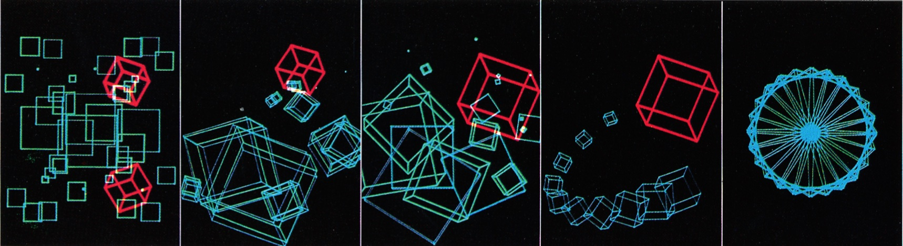

Whitney solía comparar su trabajo de arte por computadora con la música, ya que ambos comparten una experiencia “tensional” y de “armonía visual”. Para el artista, históricamente ha existido una búsqueda humana por la "música visual" (*visual music*), desde Leonardo da Vinci, quien fue de los primeros en poner en palabras esta idea, hasta la cronología de los Color Organs, invenciones que buscaban generar luz y color como si se tocara un instrumento musical. Whitney percibe sus invenciones como parte de esta familia de instrumentos y experiencias de música visual, lamentándose que en su momento no pueda controlarse directamente la interacción en tiempo real con la máquina, algo que espera pueda realizarse en el futuro [@musilliFilmArtJohn1974].

Es interesante pensar cómo la técnica de los Whitney deriva en una tecnología que permite preservar las copias de su trabajo hoy. Los experimentos audiovisuales de los Whitney dejan en evidencia la particularidad del soporte, además del valor documental y, por ejemplo, la posibilidad de hacer copias nuevas 50 años después. El _Academy Film Archive_ de la Academia de Artes y Ciencias Cinematográficas (AMPAS por sus siglas en inglés) preserva docenas de los films de los Whitney [@JohnWhitneyAnimator2023].

El proceso de transferencia de imágenes en video o digitales a medios fotoquímicos tradicionales es conocido de forma general como Film-out o Digital-to-film. En el pasado en general este paso cumplía objetivos técnicos de distribución, principalmente para películas realizadas en formatos digitales o analógicos que requerían de una conversión óptica para copias en 35 mm para su distribución en cines. Hoy en día la práctica se encuentra muy reservada a casos específicos de archivo o se basa casi exclusivamente en una decisión artística o estética. Según la revista norteamericana _Filmmaker Magazine_, en Estados Unidos en 2021 se estrenaron 30 películas rodadas total o parcialmente en fílmico [@rizovApproximately30Movies2022], en 2022 solo 24 [@rizov24Features20222022] y en 2023 menos de 30 [@rizov29FeaturesShot2023]. Sin embargo, en menor medida también siguen existiendo laboratorios que ofrecen el servicio de "digital a fílmico" a escuelas de cine y producciones independientes, y particularmente a cineastas experimentales que ruedan en fílmico, editan en digital y finalizan en fílmico nuevamente, ya que las emulsiones intermedias para hacer copias directas se encuentran en desuso[^12]

El caso de _Dune_ (2021), del director Québécois Denis Villeneuve, es un caso contemporáneo de digital-to-film. Filmada en digital en su totalidad, fue transferida posteriormente a digital para luego ser nuevamente digitalizada para la posproducción [@aldredgeWhyDuneWas2021].

En la línea de formatos y soportes inesperados, es interesante mencionar la tecnología de la empresa noruega Piql, dedicada a soluciones de almacenamiento y preservación de datos digitales. Además de trabajar para la industria audiovisual generando copias en fílmico de películas (digital to film), también ofrecen el servicio de copias en film de archivos digitales de cualquier tipo, también almacenadas en película de 35 mm. El sistema codifica cada bit del archivo digital a una forma de luz en la película, para formar largas cantidades de film que son luego almacenadas y, en todo caso, decodificadas posteriormente con la misma máquina. En general también incluyen referencias gráficas o humanamente legibles al documento original[^13].

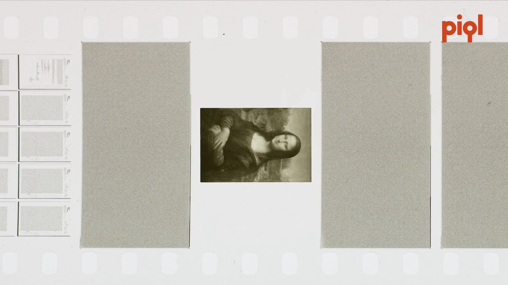


Es conocido el uso de esta tecnología para el proyecto _Arctic World Archive_, un programa de archivo y preservación en la isla de Spitsbergen, en Noruega. El _AWA_ “contiene información histórica y cultural de varios países, además de todo el código abierto de GitHub, (…) con una expectativa de vida de 500 a 2000 años, almacenado en las condiciones adecuadas” [@ArcticWorldArchive2021].

Esta técnica de encriptación y guardado no es de uso exclusivo de las grandes empresas. Existen alternativas de código abierto muy fáciles de implementar en archivos propios, como el proyecto de Alisina Bahadori _Paperify_ inspirado en el _Arctic World Archive_, que convierte cualquier tipo de formato digital en una serie de códigos QR adaptados a páginas A4 listos para ser impresos y resguardados. Los códigos QR normales solo guardan información en forma de texto ("strings") y no admiten archivos codificados en binario ("unos" y "ceros"), pero existen formas de convertir un archivo binario a texto con una técnica de codificación conocida como _base64_. Un código QR admite hasta 177x177 módulos, aproximadamente 4000 caracteres con los que trabajar, que equivalen a 3 kb. _Paperify_ separa el archivo en múltiples partes (o _chunks_) de hasta 3 kb, los codifica en código QR y los guarda como páginas en formato PNG para ser impresas, y si son digitalizadas nuevamente el programa también permite la decodificación y reconstrucción del archivo, siempre y cuando se tengan todos los _chunks_. _Paperify_ tiene sus limitaciones: "cada página creada con Paperify puede contener hasta 2953 bytes de datos. Entonces, por ejemplo, un archivo de 100 KB ocupará 35 páginas, un archivo de 1 MB ocupará 356 páginas. Por lo tanto, para archivos de más de 290 KB (~100 páginas) no es conveniente utilizar Paperify" [@bahadoriPaperifyHowBackup2020].

## Arte con computadoras en papel

Vera Molnar (1924 - 2023) es una artista visual húngara pionera en el campo del arte generativo y por computadora que desarrolló la mayor parte de su carrera en Francia. Interesada en formarse como pintora de arte abstracto, se mudó a París al terminar su carrera de arte en Budapest. Aunque solo usaba herramientas tradicionales, como lápices de colores, pinceles y pasteles, antes de empezar a trabajar con computadoras en 1968 Vera recuerda haber inventado varios métodos sistemáticos para hacer arte, incluso desde una edad temprana. Antes de tener acceso a una computadora, Molnar trabajaba con lo que ella llamaba _le machine imaginaire_, una computadora imaginaria con la que generaba series de imágenes emulando movimientos aleatorios con un dado, y haciendo pequeños desplazamientos morfológicos y matemáticos de las formas.

Molnar (que casualmente perteneció al mismo colectivo artístico que el mendocino Julio Le Parc en París) al igual que otros artistas como Georg Ness, Frieder Nake o Michael Noll, trabajaba en papel con plotters, grandes computadoras que traducían a papel instrucciones y procedimientos. La historiadora y artista norteamericana Zsofi Valyi-Nagy describe en un dossier sobre Vera Molnar que la artista se especializaba en los "Drum Plotters", que a diferencia de los "Flatbed Plotters" tenían una fuente continua de papel, como una impresora [@valyi-nagyHOLODossierVera2022].

En un entorno artístico de mucha riqueza, su vínculo con las computadoras se dio a través de su amigo Pierre Barbaud, un compositor experimental que la invitó en 1968 a la Universidad de Borbona a conocer la computadora que utilizaba para su investigación en música, una IBM system/370, con la que Molnar comenzó clandestinamente a experimentar. La mayoría de sus obras de los 70 tienen impresa la marca del plotter "Benson" en los márgenes. Valyi-Nagy explica que el formato de tinta sobre papel es quizás lo que ha permitido a los museos de arte coleccionar su obra de manera más extensa que otras formas de arte digital, ya que no necesitamos preservar tecnologías obsoletas para verla. Sin embargo, su aparente sencillez también corre el riesgo de simplificar nuestra comprensión del arte por computadoras temprano en un simple proceso de entrada y salida [@valyi-nagyHOLODossierVera2022].

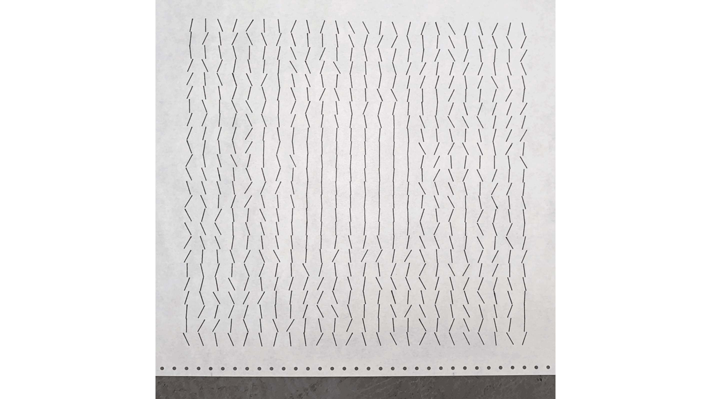

El trabajo de Molnar implicaba una vuelta constante entre papel y computadora, relación que mejoró mucho con la existencia del monitor. Esta nueva herramienta le permitió incorporar al proceso tan sistematizado y predeterminado un elemento de improvisación e interactividad directa desde su subjetividad a la obra, contrario a la limitación que implicaba esperar que el resultado terminara impreso en papel. Molnar explicaba que pertenecía a una generación en la que las primeras cosas que se hacían con computadoras, no había pantallas. No se podía ver lo que se estaba haciendo. Se verían los resultados al día siguiente, o tres días después, para luego decir que no era lo que se quería. La artista cuenta que cuando apareció la pantalla, su vida cambió por completo: "fue como mudarme a París de nuevo, así de emocionante fue... tenía la sensación de que había sido inventado para mí" [@valyi-nagyHOLODossierVera2022].
 


En esta misma línea es interesante encontrar una continuidad histórica con los llamados _Paper Prints_, un sistema de guardado de películas para el registro de propiedad intelectual hacia finales del siglo XIX y principios del siglo XX en los que se archivaban los fotogramas de las películas. Dado que legalmente no existían antecedentes en el Registro Nacional de la Propiedad Intelectual de Estados Unidos, las películas se transferían a papel y se las registraba como obras gráficas. Casualmente, fue el gran inventor de tecnologías, Thomas Alva Edison, el primero en registrar una película con este sistema en 1893, y la Biblioteca del Congreso de EEUU procesó y catalogó desde entonces cada una de las películas como una sola fotografía, aceptando miles de impresiones en papel durante un período de veinte años [@PaperPrint2023].


Un efecto secundario afortunado de esta técnica es que mientras las películas y negativos reales de este período a menudo se deterioraban o eran destruidos, las impresiones en papel permanecían ignoradas y guardadas. En muchísimos casos gracias a los Paper Prints es que se conservan  películas de esa época, pues por falta de interés, por la naturaleza de los materiales (como el nitrato autocombustible) o por los requisitos legales, muchas copias se perdían para siempre [@rewaldJohnHayWhitney1983].

También hay referentes del uso de esta tecnología en el continente asiático. El proyecto _Japanese Paper Film Project_ de la universidad de Bucknell, Pensilvania, es un trabajo dedicado al rescate e investigación de las _kami firumu_, las películas producidas directamente en papel en el Japón de principios del siglo XX. De 1932 a 1938, dos empresas japonesas dominaron el mercado de las películas de papel: _REFCY_, con sede en Tokio, y _Katei Toki_, con sede en Osaka. Se producían películas animadas y fotografiadas y, a menudo, a color. Además, muchas de las películas contenían sonido sincronizado en vinilos de 78 rpm. Dado el corto período de producción, la diferentes calidades del papel y la devastación de la Segunda Guerra Mundial, muy pocas copias de estas películas sobreviven. El proyecto se basa en la documentación y la digitalización de las películas que, dada la naturaleza irregular del soporte, requirió de un diseño de hardware y software particular para el proyecto [@fadenJapanesePaperFilm2023].


## Los medios variables
 
Los "Time-based Media" son aquellos medios que se "despliegan" en el tiempo, y a pesar de que muchas veces son de naturaleza tecnológica, es un nombre flexible que engloba disciplinas desde cine y video hasta instalaciones, arte electrónico y performance. En general estas obras, que son muchas veces de naturaleza efímera, dependen de su formato desplegado en el espacio, o de ciertas tecnologías específicas que hacen posible su desarrollo y ejecución. Son medios inestables, en constante cambio y actualización. Mientras que existen estándares internacionales para el manejo, instalación y cuidado de obras de arte tradicionales, derivados de milenios de restauración arquitectónica, pictórica y artística en manos de artistas de todo el mundo, y luego a partir del Siglo XX concentrados y estandarizados por museos e instituciones occidentales como puede ser el _British Museum_ o los _Staatliche Museen_ en Berlin, en el grupo de los Time-based los métodos suelen ser más jóvenes y son principalmente estudiados por instituciones específicas en cooperación con estándares de industrias audiovisuales y tecnológicas.

El arte electrónico en particular es un término amplio que abarca distintas expresiones artísticas contemporáneas que utilizan tecnologías electrónicas y/o digitales. En el artículo _Album inestable, una acercamiento a la conservación del arte electrónico_, la investigadora argentina Vanina Hofman enumera y desarrolla criterios y limitaciones a la hora de preservar arte electrónico, que en relación a otros soportes que podríamos llamar "tradicionales", se encuentra en una etapa más incipiente. Según la autora no existen criterios únicos ni normas generales, por tanto se ha vuelto fundamental el trabajo en base a casos de estudio. Uno de los planteos es que para poder preservar arte electrónico este debe transformase. En este aspecto podemos encontrar una continuidad conceptual con la idea "transicional" que mencionaba Fossati en _Del Grano al Pixel_, y podríamos pensar al arte electrónico como uno de los medios más híbridos y transicionales, ya que para su conservación requiere del archivista una posición activa de recreación y transformación. Esto va en contra de la imagen generalizada del coleccionismo de los archivos y de su asociación a cierta idea de inmutabilidad. La conversión constante de la obra en post de su perdurabilidad puede orientarse hacia el plano de la documentación y también hacia la transformación física concreta en virtud de su presentación futura [@hofmanAlbumInestableAcercamiento2007].

Hofman junto a Consuelo Rozo del grupo _Taxonomedia_ explican en el texto que acompaña al seminario _Conservación de Arte Electrónico: ¿Qué preservar y cómo preservarlo?_ algunas nociones de lo que implica conservar este tipo de arte y nos introducen a la idea de "transformación". Lejos de pensar la conservación como una acción de fosilizar o congelar la materialidad de una pieza, la conservación del arte digital se acerca más a la idea de “transformar para conservar”: ¿Qué pasa cuándo lo que queremos conservar ya no es un objeto en sí mismo sino un proceso que sucede en tiempo real mediado por una unidad tecnológica? [@hofmanConservacionArteElectronico2009].

En el caso de las artes electrónicas, donde se requiere de un ecosistema orquestado para su funcionamiento, es muy frecuente encontrarse con páginas web caídas, programas incompatibles con determinados sistemas operativos y licencias para usar programas caducas o inexistentes. Esto requiere de un estado de actualización y mutación constante a la hora de mantener con vida estas obras donde la obsolescencia ocurre muy rápidamente. Parecido al caso de Bill Brand al restaurar la obra de Paul Sharits: mientras se mantenga una empatía con la estrategia original del artista, es muy posible rehacer la obra con nuevas tecnologías. También se puede diseñar desde el papel del artista procesos para desacelerar esta inevitable caducidad, utilizando software de código abierto, mecanismos sencillos y adaptables, obras duraderas y dedicadas. Lo más importante sigue siendo la documentación como la principal herramienta de preservación.

Esta documentación y recreación de las obras de arte digital es lo que Lino García Morales llama "conservación evolutiva". "El concepto de conservación evolutiva es imprescindible en la restauración de arte digital", y refiere a las estrategias de preservación frente a la obsolescencia tecnológica. "La recreación permite una conservación evolutiva, en completa armonía con la naturaleza del arte digital" [@moralesTeoriaConservacionEvolutiva2019, p. 14].

Hofman explica que en el arte electrónico hay un aspecto importante a considerar: la distinción entre la preservación de la documentación sobre una pieza, y la materialidad de la pieza, dos esferas paralelas y casi indivisibles. La materialidad no es siempre la prioridad en este tipo de obras, porque muchas veces son de naturaleza efímera [@hofmanAlbumInestableAcercamiento2007]. Por otro lado, la autora hace una diferencia entre la preservación pasiva de una obra y la preservación activa. La primera refiere a todas aquellas acciones que no significan una transformación directa de las piezas, como puede ser mantener luz, temperatura y humedad en condiciones controladas. Y la segunda refiere concretamente a la idea de transformar para conservar: reparar, migrar la pieza a nuevos soportes, emular las condiciones de presentación de las obras, o incluso reinterpretar la intención y el sentido original del autor.

Con estas forma general de preservación que resulta del equilibrio entre información y documentación y entre acciones pasivas y activas, a continuación se van a mencionar algunas instituciones y fundaciones que desarrollaron distintas escuelas y diversos modelos de organización de la documentación para las obras de la llamada "media variable".

Un gran ejemplo de conservación evolutiva es el proyecto online _ReCode Project_ ideado por Matthew Epler, un esfuerzo colaborativo para mantener con vida obras de arte por computadora de artistas del pasado, como pueden ser Vera Molnar, John Whitney, Frieder Nake, Kenneth Knowlton, Herbert Franke, Michael Noll, Edward Zajac, etc. La idea fundamental de la plataforma es recrear de forma colectiva y abierta obras hechas por computadora con lenguajes de programación contemporáneos a partir de documentación de archivo. La lista de artistas es extensa y basada en revistas y publicaciones especializadas de la época. Por ejemplo, una de las colecciones que existen en el sitio está basada en la publicación _Computer Graphics and Art_, una revista de arte por computadora publicada entre 1976 y 1978. Cualquier usuario se registra, elige de la lista un autor, selecciona entre realizar una traducción literal o libremente inspirada, y finalmente agrega su interpretación a la base de datos. A través de esta transformación se busca recrear la naturaleza procedural de obras de las que quizás solo se conservan en su forma gráfica, impresas en una revista o como piezas originales. Según los autores, los principales objetivos del proyecto son volver a poner en circulación obras pioneras de arte por computadora, ofrecer recursos de aprendizaje a estudiantes y educadores, e incentivar una comunidad activa [@eplerReCodeProject2012].

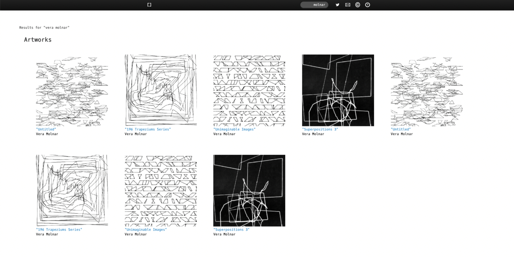

Por otro lado, La _Variable Media Network_, fundada por el Museo Guggenheim con apoyo de la Fundación Daniel Langlois, es una red de instituciones y expertos que tiene por objetivo el establecimiento de protocolos que permitan un acercamiento flexible a la preservación de prácticas artísticas basadas en "media variable" (esto incluye lo que conocemos por arte electrónico, aunque se extiende a casi toda forma de arte). El modelo de organización de esta red es una herramienta de base de datos en forma de cuestionario: el Cuestionario de Media Variable (VMQ por sus sílabas en inglés), una interfaz gráfica online no convencional que le permite a los creadores e investigadores registrar una obra y su funcionamiento a través de preguntas y modelos de organización específicos alrededor del paradigma de los medios variables: el sentido independiente del medio. Por ejemplo, pueden almacenar "interpretaciones" de tamaños, "partes" de una obra con sus respectivas "preguntas", y también "participantes" de la obra y "entrevistas" que pueden sumar más información a la pieza. La subjetividad de los participantes de cada obra también le permite a la herramienta establecer criterios muy versátiles de cuatro factores esenciales: almacenamiento, migración, emulación y recreación. La herramienta cuenta con modelos de piezas preestablecidos que le permiten a quien carga la información partir de una base similar para ampliar y completar. La intención de la herramienta es "determinar la forma en el cual los creadores desearían que su obra sea re-creada (siempre y cuando esto sea posible), con independencia del medio en el fue realizada" [@hofmanAlbumInestableAcercamiento2007].[^14]


Otros modelos o bases de datos se pueden entender como el punto medio entre documentación y difusión. Tal es el caso de Media Art Net o Rhizome ArtBase, entre otros, donde artistas aplican y documentan en pos de difusión y conservación.

Una institución digna de mencionar es el _Matters in Media Art_, un proyecto de cooperación entre instituciones como los museos MoMA y TATE alrededor de la preservación de obras basadas en tiempo, consultando a expertos y preparando guías para el desarrollo de esta práctica. Este consorcio apunta a generar material para coleccionistas, artistas e instituciones de todos las escalas. Las guías son exhaustivas, asesorando alrededor de la adquisición, la documentación a realizar, cómo llevar a cabo préstamos, y cómo preservar digitalmente estas obras que alcanzan su apogeo en su forma desplegada. El trabajo que plantea el consorcio compete disciplinas muy diversas y requiere trascender y confrontar prácticas de archivo y preservación tradicionales. Curadores, archivistas, técnicos en informática, conservadores y expertos contribuyen a estas diversas obras de arte. Algunos ejemplos de estas guías son de obras de video, audio, cine, y diapositivas, pero también ofrecen guías para tratar las computadoras, las pantallas, los reproductores y los proyectores.[^15]

En relación al Moma, este museo está adquiriendo desde 2012 videojuegos a su colección, como parte del acervo de piezas de arte y diseño, y es un buen ejemplo de preservación de documentación. La institución aspira a incorporar una lista de por lo menos 40 juegos, entre los que ahora podemos encontrar títulos como _Pac-Man_ (1980), _Tetris_ (1984), _Another World_ (1991), _Myst_ (1993), _SimCity 2000_ (1994), _The Sims_ (2000), _Dwarf Fortress_ (2006), _Portal_ (2007), entre otros. La colección también incluye consolas de videojuegos como la _Magnavox Odyssey_ de 1972. Los curadores del departamento de diseño y arquitectura Paola Antonelli y Paul Galloway escriben en 2022 un artículo que acompañó la exhibición _Never Alone: Video Games and Other Interactive Design_ la experiencia a la hora de adquirir y preservar el material. En primer lugar explican que fue indispensable hacerse del código fuente de los juegos, ya sea en forma digital o física (cartuchos o consolas), para poder traducirlo en el futuro si la tecnología original queda obsoleta. Esto incluyó emuladores de las consolas en caso de que los hubiera, y documentación de los programadores originales, porque escribir código es un proceso personal y creativo que a veces requiere del autor de primera mano. La segunda parte fue pensar la exhibición de los juegos en su dimensión temporal, ya que son productos que no fueron especialmente diseñados para ese tipo de expansión en el espacio, por lo que se llegó a clasificar el juego según su "duración", desde experiencias cortas de 5 minutos a juegos prácticamente infinitos como el Sim City 2000 [@antonelliWhenVideoGames2022].

También se puede mencionar el _Computerspiele Museum_ en Berlín, un museo dedicado a la conservación y preservación de videojuegos, desde el software al hardware, financiado por el Consejo Internacional de Museos. También la Fundación Langlois en Montreal, Canadá, que desarrolla metodologías y herramientas con relación a la preservación y documentación de piezas artísticas digitales, tecnológicas y electrónicas por medio del proyecto DOCAM (Documentation et Conservation des Arts Médiatiques). O el Netherlands Media Art Institute, Montevideo/Time Based Arts (ahora LIMA), que desde 1992 investigaba y desarrollaba modelos, métodos de registro, teorías y acciones en torno a la conservación, orientadas hacia su objetivo central de hacer accesible la herencia cultural del arte electrónico. Por último, el Museo Nacional y Centro de Arte Reina Sofía tiene una publicación periódica titulada "Conservación de Arte Contemporáneo" que recoge las ponencias presentadas anualmente en la Jornada de Conservación de Arte Contemporáneo del Departamento de Restauración del museo.

Como se puede apreciar en este apartado, el mayor número de instituciones y proyectos alrededor de la preservación de arte electrónico ocurren en Europa, Estados Unidos y Canadá, donde también incluso se lucha contra la falta de fondos y personal para llevar adelante esta proeza de documentación y preservación.

En Sudamérica no es diferente, pero existen muchos ejemplos de investigación, promoción y difusión institucionales y también independientes, como el Centro de Documentación de las Artes en el Palacio de la Moneda en Chile, o lo que ocurre en algunas instituciones culturales, concursos, festivales, circuitos de exhibición y carreras de grado y posgrado en Argentina, como el Espacio Fundación Telefónica (Movistar), el Centro Cultural de España en Buenos Aires, festivales y concursos como los del Proyecto Experimental Limbo, Game-On El Arte En Juego, circuitos de exhibición y producción alternativos o no gubernamentales como el Centro Hipermediático Experimental Latino Americano (cheLA), y ofertas formativas de grado y posgrado como las Licenciatura y Maestría en Artes Electrónicas de la Universidad Nacional de Tres de Febrero (UNTREF), las actividades que lleva adelante el Instituto Universitario Nacional del Arte (IUNA), o la cátedra de Campos Trilnick de la Carrera de Diseño de Imagen y Sonido de la Universidad de Buenos Aires, que lleva adelante desde hace años una importante tarea de formación en las especificidades propias de los medios digitales audiovisuales.

También vale mencionar la labor de la revista _Replay_, dedicada a la arqueología e investigación alrededor de la historia de los videojuegos y el entretenimiento digital en el territorio nacional, donde en cada edición se investiga una nueva historia de Arcades, los muebles para los "fichines", la historia de Sacoa, desarrolladores locales, industria nacional, etc; y también en forma independiente y a nivel local la base de datos de obras de net-art que desarrolla el artista uruguayo Brian Mackern.

## Arqueología para el arte digital

Brian Mackern es un artista uruguayo que ha desarrollado la mayor parte de su obra alrededor del net art y el sound art. Realiza experimentos con proyecciones, datos y colaborando con artistas sonoros y musicales. A través de sus trabajos de “arqueología digital” lleva adelante un proyecto de divulgación y conservación de net art latinoamericano. El autor destaca la importancia de los archivos digitales, y la importancia de mantener las computadoras para las que funcionaban esos archivos digitales. Desde el año 2004, se dedica a la recuperación, conservación y preservación de obras de netart de los años 90, tanto como investigador como artista.

Su proyecto más conocido es la "netart latino database", un base de datos que funciona como un esfuerzo por documentar obras de arte basadas en internet, vulnerables a la obsolescencia, realizadas por artistas latinoamericanos, trabajando en la periferia de las comunidades dominantes de net art de habla inglesa. El netart "tuvo tantos nombres como 'centros de gravedad creativa' y comunidades dedicadas al tema: netart, arte de red, arte de Internet, arte net, net arte, ambientación web (este último término (...) se refiere más bien al diseño de sitios con navegación laberíntica apoyado por cantidad de enlaces aleatorios, algo muy de moda en los años noventa)" [@mackernNETARTLATINODATABASE2008].

> _"database" surge con una intención totalmente particular y subjetiva en cuanto a criterios. Como toda selección personal, es "parcial y arbitraria", nunca pretendió ser un mero listado. Tiene un gran componente personal en el sentido de que ahí se encuentran enlaces que, en lo personal y como artista, me interesaban por algo en especial, generalmente por su búsqueda estética, su propuesta formal, su manifiesto, su relectura, etc. Casi todos los enlaces fueron en su momento sopesados y reflexionados, navegados a conciencia. Eran mis recomendaciones personales de navegación y a la vez un mapeo de la red en la que me movía en ese momento. Una cartografía de relaciones y de trabajos de reflexión y colaboración_ [@mackernNETARTLATINODATABASE2008].


Así como las tecnologías cambian en el tiempo surgen los plugins deprecados (la muerte de la plataforma Flash, por dar un ejemplo) y los llamados "hipervínculos podridos" (_linkrots_ en inglés). En este contexto de decaimiento digital surge la importancia del trabajo de la "database". 

Su otro proyecto importante es _La Máquina Podrida_ (_aka La Desdentada_), que consistió en una exposición de su propia computadora portátil que lo acompañó desde 1999 a 2004, en la que desarrolló muchas de sus obras como artista y coleccionista, en la que archivó obras de otros en relación al net art, como Jodi, Superbad, Rafael Lozano-Hemmer, entre otros. La computadora se encuentra en su estado original, con el sistema operativo necesario para correr correctamente todas estas aplicaciones, gifs animados y páginas. De no ser por la forma en que fueron guardadas y en la forma que son ejecutadas, estos archivos posiblemente se hubieran perdido, puesto que en muchas ocasiones ni los propios artistas llegaron a guardar sus obras, pero Brian conservó copias por su interés personal [@MEIACMuseoExtremeno].

El Museo Extremeño e Iberoamericano de Arte Contemporáneo termina comprándole a Mackern La Máquina Podrida y la "netart latino database", y en este ciclo que podría verse como una paradoja, la "colección surgida desde los márgenes, tal como en los casos de Langlois y Prelinger, las piezas reunidas por un interés personal –o por una sensibilidad hacia el futuro particular– acaban en una institución de acceso público que las cobija, las protege y las difunde." [@hofmanMiradasDivergentesPara2011]


Esta idea del valor agregado sobre dispositivos tecnológicos o de almacenamiento de uso común también la trabaja el artista Español Solimán López con su proyecto _Harddiskmuseum_ (literalmente "museo del disco rígido"), y consiste en una colección de obras de arte digitales únicas de distintos artistas almacenadas en un disco rígido físico de 2 TB de capacidad. En su manifesto Solimán se compromete a "ser el portador de este objeto que es como la piedra roseta del arte contemporáneo" [@lopezCreandoPiedraRosetta2015].

"Considerando que el coleccionista amateur tiene una idea de valor para aquello que cuida, es perfectamente coherente que después de poseerlo y ponderarlo, desee compartirlo y posibilitarle una continuidad que exceda su propia vida" [@hofmanMiradasDivergentesPara2011]. En esta línea podríamos acercarnos nuevamente a la idea de "preservación involuntaria", porque si bien en Brian Mackern la preservación "amateur" de las piezas termina siendo parte de la obra en sí, pareciera haber una coincidencia entre la búsqueda estética personal y los intereses del autor, y los resultados de preservación consiguientes. Muchas obras, propias y ajenas, fueron preservadas en el tiempo gracias a este interés, que ahora es medular en su trabajo. En el apartado siguiente vamos a profundizar un poco más sobre los archivos de internet y sus posibilidades contemporáneas.

## Preservación descentralizada

¿Qué es la descentralización? Según la documentación del sitio fxhash.xyz la descentralización implica distribuir el control y la autoridad a una red de participantes en lugar de depender de una única autoridad central, como un servidor o una empresa tradicional. En un sistema descentralizado, los datos y procesos se distribuyen entre muchos nodos u computadoras, lo que hace que la red sea más resiliente, más resistente a la censura y menos dependiente de un único punto de falla. Este cambio hacia la descentralización tiene como objetivo empoderar a las personas, dándoles un mayor control sobre sus datos, identidades e interacciones en línea, y reduciendo el dominio de las entidades centralizadas en el panorama digital [@DecentralisedStorageIPFS2022].

En internet se habla de democratización y distribución, ya sea desde los principios y las bases del software libre hasta los sitios web basados en el _croudsourcing_ (que podría traducirse a colaboración abierta distribuida, como es el ejemplo de _Wikipedia_). Existen valores e ideales con sustento en algunos sitios de piratería, donde la confianza se basa en las ideas de un acceso universal a la cultura y la retribución a los autores se basa en el mérito y la solidaridad. Y en la _Blockchain_ nada es privado, toda la información es pública y permanente. Existen familias que depositan toda su confianza de archivo en servicios como Facebook, Instagram, Google y Amazon, y aunque no quiera decir que la cultura del archivo dependa de esto, la existencia de todo tipo de documentos y sitios web muchas veces dependen de este tipo de compañías privadas. Existen excepciones que se verán más adelante, como el proyecto sin fines de lucro Internet Archive, o el proyecto de código abierto y descentralizado de sistema de archivos _Inter Planetary File System_. En esta vorágine de tormenta tecnológica surge la colectividad y el carácter “abierto” de las computadoras e internet, y se prioriza la creación de contenido por parte del usuario a través de sitios y aplicaciones. La práctica de archivo  está cambiando muy rápidamente y en este apartado vamos a contextualizar cómo se preserva internet.

La ley de Moore, formulada en 1965 por el fundador de Intel, Gordon Moore, estima que aproximadamente cada 2 años se duplica la cantidad de transistores en un microchip (y por lo tanto la capacidad de las computadoras). En el contexto de los archivos del mundo, la realidad se ve desafiada y amenazada continuamente. Giovana Fossati explica que la práctica de archivo cinematográfico está cambiando muy rápidamente y con ello la forma en que vemos la preservación de nuestro patrimonio cinematográfico. Según la autora se están desarrollando nuevas formas de archivos (digitales) a través de Internet que hacen uso de medios participativos para proporcionar un acceso significativamente más amplio y abierto que cualquier archivo tradicional haya ofrecido antes, y como consecuencia, los archivos cinematográficos y los museos de cine están haciéndose preguntas sobre su rol. Podrían cerrar sus puertas a los nuevos medios, o aceptarlos y desafiar algunas de sus visiones y suposiciones sobre el medio cinematográfico, pero sea cual sea la elección, esta determinará su futuro [@fossatiGrainPixelArchival2018, p. 23].

Además de la inestabilidad en lo digital o de la dependencia de compañías privadas, uno de los problemas de la preservación en internet es la incredulidad del público general sobre su ineludible efectividad. En el caso de Instagram, por ejemplo, no es raro encontrarse con cuentas dedicadas a mascotas o hijos, muchas veces de acceso privado, en las cuales sus promotores depositan toda su confianza como dispositivo de archivo. Si bien Facebook, con casi 20 años de historia al momento de escribir esta tesis, puede sugerir al usuario una idea de archivo eficaz, no hay real conciencia sobre cómo funciona la máquina (o el dispositivo), y es ahí donde debería pararse un archivista o un artista.

El conocimiento general de la "nube" es similar a la idea de caja negra: pareciera tratarse de un elemento etéreo, invisible, infinito, donde la capacidad es ilimitada, ignorando quizás los _datacenters_ físicos distribuidos por todo el mundo. Los servidores de _Amazon Web Services_, o AWS, la empresa subsidiaria de Amazon que ofrece servicios de almacenamiento y computación en la nube, concentran hasta el 70% del tráfico web mundial y, según algunas fuentes, un tercio de los sitios web del mundo se basan solamente en los servidores de esta compañía [@burringtonWhyAmazonData2016]. El éxito de AWS y la facilidad con la que la gente se olvida del carácter físico de la nube pareciera basarse en su hermeticidad: tanto las ubicaciones geográficas de sus datacenters como sus clientes se mantienen en secreto, lo que contribuye a la abstracción casi total de la infraestructura real.

_Internet Archive_ (literalmente archivo de Internet) es una biblioteca digital sin fines de lucro dedicada al archivo y preservación de sitios web, libros, audio, software, imágenes, películas y videos. Funciona como un sitio de consulta permanente, de uso libre, desde 1996, nacido principalmente como un proyecto de guardado de sitios web, en pleno auge del internet de modo masivo. En la actualidad una sola copia de todo el archivo supera los 70 petabytes (1 petabyte = 1024 terabytes). Es de uso libre, como el sistema de crowdsourcing de Wikipedia, y tiene asociaciones con bibliotecas y archivos de todo el mundo, lo que lo hace además de un proyecto a escala mundial, un trabajo colaborativo. “Nuestra misión es ofrecer acceso universal a todo el conocimiento”.

Sin duda uno de sus servicios más atractivos es la _Wayback Machine_, nacida en pleno auge de los sitios web en los 90 como un proyecto de guardado automático de páginas. De manera automática los _crawlers_ toman _snapshots_ de sitios públicos, para guardarlos cronológicamente en un calendario, donde el usuario puede (o no) conseguir versiones anteriores a las disponibles online o inclusive visitar páginas ya extintas, como por ejemplo los sitios de Geocities de los años noventa o los perfiles de Fotolog de los años 2000. Funciona bien con páginas de html básico pero todo lo que requería de sistemas externos como Javascript o Flash no funcionan al día de hoy. De hecho la Wayback Machine es una excelente lección de lo vulnerable de los archivos digitales, porque la mayoría de los sitios web se encuentran perdidos o inutilizables. Lo mismo sucede con mucho software y no tanto pero también con formatos de video. El caso de los videojuegos es interesante porque muchos tienen incorporado un emulador con el que se pueden jugar en el sitio mismo, por lo que juegos para la Atari, DOS o Commodore 64 pueden visitarse directamente desde el explorador.

Pero, ¿qué es _Internet_? en general el término refiere a los cables, a los protocolos y a la tecnología; y _web_ (también conocida como _red_ en español) a los buscadores, las aplicaciones, los programas. “Web 1.0” hace referencia a los sitios estáticos y de “solo lectura” de hasta principios de los 2000. “Web 2.0” a la naturaleza dinámica e interactiva de los sitios post-2000, también conocida como “read/write web”: los usuarios pueden leer información y subir su propio contenido, utilizando programas y a través de intermediarios. Y para la “Web 3.0”, se plantea la idea de “confianza” (trust): se conectan los programas con el contenido, se eliminan las organizaciones intermediarias, y se suma la “verificación pública” [@benetWhatExactlyWeb32018].


En este contexto de la Web 3.0 se habla mucho de lo descentralizado, y por supuesto también de su gran protagonista, la _Blockchain_: un mecanismo de datos cuya información se agrupa en conjuntos (bloques) a los que se les añade metadata relativa a otro bloque de la cadena anterior en una línea temporal. Gracias a esto la información contenida en un bloque solo puede ser editada modificando todos los bloques posteriores, lo que la hace segura y verificable. Tiene múltiples usos, desde financieros, legales, y hasta democráticos.

El "Sistema de Archivos Interplanetario" (_IPFS_ por _InterPlanetary File System_ en inglés), es un sistema de guardado de archivos “en la nube” basado en la tecnología de la Blockchain, pariente del sistema de archivos de los torrents. Los sitios subidos a la _IPFS_ son distribuidos entre múltiples usuarios participantes, lo que permite que si el server original de un sitio cae o desaparece, todavía se pueda acceder a esta información por estar dividido y descentralizado en muchas computadoras en el mundo. También permite, por ejemplo, revisar versiones anteriores. “Los inventores del internet están intentando construir una red verdaderamente permanente” es el nombre que lleva un artículo de la revista norteamericana WIRED. En ella comparan la obsolescencia de los Floppy Disk con la de muchísimos sitios web ahora extintos, la centralización que implica el _Internet Archive_, y las bondades de los archivos basados en papel. “Le estamos dando a la información digital una cualidad parecida al papel” dice el fundador del IPFS, Juan Benet [@finleyInventorsInternetAre2016].

La gran mayoría de los NFT están respaldados a través de esta tecnología descentralizada, vinculados además con la _Blockchain_, aunque no concretamente a la red de _Bitcoin_, sino a otras más nuevas, como _Ethereum_, _Tezos_, o _Cardano_. Sin embargo, que estos sistemas sean descentralizados no significa que sean baratos, y menos aún ecológicos. Si bien se sobreentiende que por algoritmos, descentralización y criptografía los archivos se preservan en el tiempo, todavía queda preguntarse si este sistema es más seguro o duradero que las películas en 35 mm de Piql, los Paper Prints de Edison o incluso los archivos de empresas privadas como el Internet Archive. A nivel ecológico, pareciera que ningún método es del todo efectivo, incluso el film implica toneladas de cartílago de animales para su desarrollo. Y un bloque de la Blockchain no preserva imágenes o documentos, sino referencias a estos, por lo que sigue siendo esencial la constante migración, mantenimiento y actualización de equipos y protocolos a nivel mundial. En la IPFS los archivos se suben a "nodos" de la red y se mantienen en circulación mientras al menos un nodo los conserve y sean consultados de manera frecuente. De no ser así, la red ejecuta una rutina de reciclaje en la que se borran archivos en desuso. Para evitar esto, existe lo que se llama "pinnear", y es una especie de forzado intencional para que incluso cuando estas condiciones no se cumplen, el archivo no se borre.  Increíblemente, al tiempo de escribir esta tesis, la plataforma _KnownOrigin_, adquirida por _eBay_ en 2022, anunció en julio de 2024 que dará de baja el sitio y mantendrá solo por dos años más el "pinneo" de los NFT en la IPFS, lo que dará lugar a la pérdida de la fuente de miles de obras almacenadas allí a partir de 2026 [@knownorigin.ioRegardingIPFSWe2024].

Cuando hablamos de que un bloque de la Blockchain no almacena imágenes sino referencias, nos referimos a que en lugar de guardar los archivos de imágenes directamente en la cadena de bloques, lo que se almacena es un enlace que apunta a donde se encuentra la imagen realmente, generalmente en un sistema de almacenamiento descentralizado como IPFS o similar. Este enfoque permite mantener la eficiencia mientras que los archivos de mayor tamaño se almacenan de manera segura fuera de la cadena. Este tipo de almacenamiento se lo conoce como "Off-Chain" (fuera del a cadena). Pero también existen los NFT "On-Chain", y son los que almacenan todos los datos directamente en la cadena de bloques, incluyendo cualquier medio asociado como imágenes, audio o videos, aunque en un formato altamente comprimido o directamente en forma de texto para ajustarse a las limitaciones de almacenamiento, que para Ethereum específicamente, son alrededor de 24 KB a 32 KB por transacción, por lo que en general son imágenes muy pequeñas en formatos vectoriales o directamente el código fuente de la obra que se ejecuta en la pantalla en tiempo real. El ejemplo más famoso de este sistema son los "CryptoPunks", una colección de personajes realizados en estilo "pixel art", aunque es más común encontrarla en plataformas de marketplace de arte generativo, por la naturaleza procedural de este tipo de obras, como el caso de fxhash.xyz, donde se combina la tecnología ONCHFS (On-chain) con IPFS para almacenar código e imagen.

En esta línea, volvamos a los sistemas de almacenamiento más tradicionales a través de un referente artístico. _Cameron’s World_ es un proyecto del artista neozelandés Cameron Askin, basado en las capacidades de archivo de Wayback Machine. Se trata de una compilación de páginas de Geocities, un servicio gratuito de alojamiento web de finales de los 90. En este período Geocities le permitió a usuarios de todo el mundo crear sus propios sitios web, llegando hasta 38 millones de páginas en su cierre en 2008. El proyecto es un tributo a esa era inocente y prolífica de internet, a través de un collage temático y estético en un largo scroll repleto de archivos gif, con una suerte de “emulador” del explorador por excelencia de esas épocas, el Netscape Navigator (disfrazado para el proyecto como “Catscape Navigator”), que nos permite ingresar a los hipervínculos y conocer más.

Esta “carta de amor al viejo internet” [@askinCameronWorld2015] , como la plantea su autor, además de una obra en sí misma, es un pequeño trabajo de preservación independiente que podríamos sumar a esta lista de esfuerzos destacados y por fuera de la maquinaria y el circuito tradicional de preservación.


La materia prima de _Cameron's World_ es el GIF, un formato de imagen introducido en 1987 por la empresa CompuServe y diseñado para una rápida descarga por su optimizado algoritmo de compresión. En épocas de poco ancho de banda y conexiones lentas, la compresión del gif permitía apreciar una imagen en tiempo real a medida que esta se cargaba. Los GIF son interlaceados, lo que significa que sus filas de píxeles no son rendereadas secuencialmente, se puede visualizar su carga "en tiempo real" y soportan 8 bits de color por canal con un máximo de 256. El GIF, que originalmente no fue diseñado para animaciones, contaba con la habilidad de almacenar fotogramas y mostrarlos secuencialmente, a velocidades variadas y con retrasos determinados. A pesar de ser uno de los primeros formatos de imagen intercambiables entre sistemas operativos, fue en 1995 cuando la empresa Netscape le añadió la habilidad de "loopear" (reproducir una y otra vez) que su popularidad se estableció para siempre.

Es un formato en parte limitado, casi deprecado en los años 90 si no hubiera sido por su capacidad de loopear, pero que cuenta con características particulares. A pesar de su compresión sin pérdida, mientras el peso lo permita, no tienen un número límite de fotogramas, y a través de la metadata del archivo se le puede establecer un retraso a cada fotograma de hasta 11 segundos. Sus limitaciones son sus aciertos. El artista y escritor Daniel Rourke escribe en su artículo _The Doctrine of the Similar (GIF GIF GIF)_ que, curiosamente provocado por su obsolescencia, el GIF se ha convertido en el medio por excelencia de los artistas web. En el artículo Rourke destaca el uso de imágenes de la cultura pop y su herencia y relación con el cine, desde que eran pequeños en tamaño y de pocos fotogramas hasta convertirse en un lenguaje visual propio, parte de la cultura memética actual [@rourkeDoctrineSimilarGIF2012].

Como ejemplo de las posibilidades del medio cabe mencionar la obra del artista finlandés Juha van Ingen, quien en 2017 creó una pieza llamada _AS Long As Possible_ (ASLAP), un gif de 1000 años de duración, de 48.140.288 fotogramas con una duración de 11 minutos cada uno, pensada para reproducirse hasta el año 3017. La obra se puede ver y forma parte de la colección de la Galería Nacional de Finlandia (KIASMA)[^16].

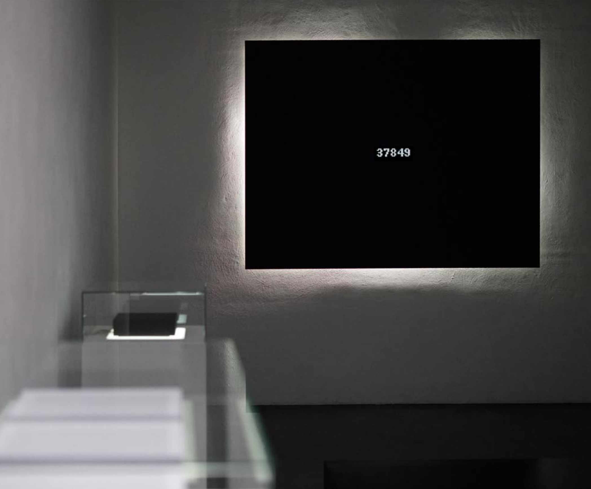

# III. Los Films Automáticos

En este último capítulo se lleva a cabo el desarrollo y la documentación de la serie "Los Films Automáticos" en primera persona. La serie es un conjunto de experimentos que oscila entre animaciones digitales y arte generativo, transferidos fotográficamente a 35 mm para ser reproducidos en distintos medios y dispositivos. Al tratarse de un proceso híbrido de múltiples generaciones, se busca problematizar y relacionar con los conceptos vistos hasta ahora, como la preservación accidental y el tiempo transicional. Animaciones 3D digitales, archivos GIF monocromáticos de baja resolución y programas generativos escritos en plataformas de código abierto son transferidos a fílmico en un proceso manual, cuadro por cuadro, para ser digitalizados nuevamente en su forma fotoquímica y reconstruídos en entornos digitales de reproducción y distribución; o son reinterpretados en su nueva forma física, para ser convertidos en diapositivas y adaptados a proyectores hogareños en desuso.

En la primera iteración se describe cómo surgió la técnica de transfer digital y su posterior re-digitalización y distribuión descentralizada, a partir de programas generativos y animaciones de baja resolución, inspirado por la nostalgia de los pioneros del arte por la computadora. En la segunda iteración se presenta por primera vez el papel del proyector de diapositivas y su potencial tecnológico y expresivo en el contexto de la tesis. Y en la tercera iteración se profundiza y desarrolla la obra en una forma optimizada, donde se trabaja con proyectores y representaciones visuales y criptográficas de archivos digitales. Los films son "automáticos" en tanto que "actúan por sí mismos", son "maquinales", "indeliberados" e "involuntarios", como el acto de preservar al que alude la tesis.

¿Por qué utilizar película 35 mm y proyectores Kodak Carousel intervenidos por automatizaciones digitales? Para responder estas preguntas es importante recuperar algunas ideas vistas anteriormente como los tiempos transicionales de Fossati y la conservación accidental de Sandusky, pero también es importante resaltar el papel de la nostalgia mediática en el uso de estas tecnologías, como así el privilegio y la responsabilidad de los artistas en el diseño y creación de sus propios dispositivos. 

Los Films Automáticos nacen en una primera instancia por accidente, por un gesto creativo intuitivo y no premeditado, a partir de la última foto de un rollo 35 mm a la pantalla de la computadora.

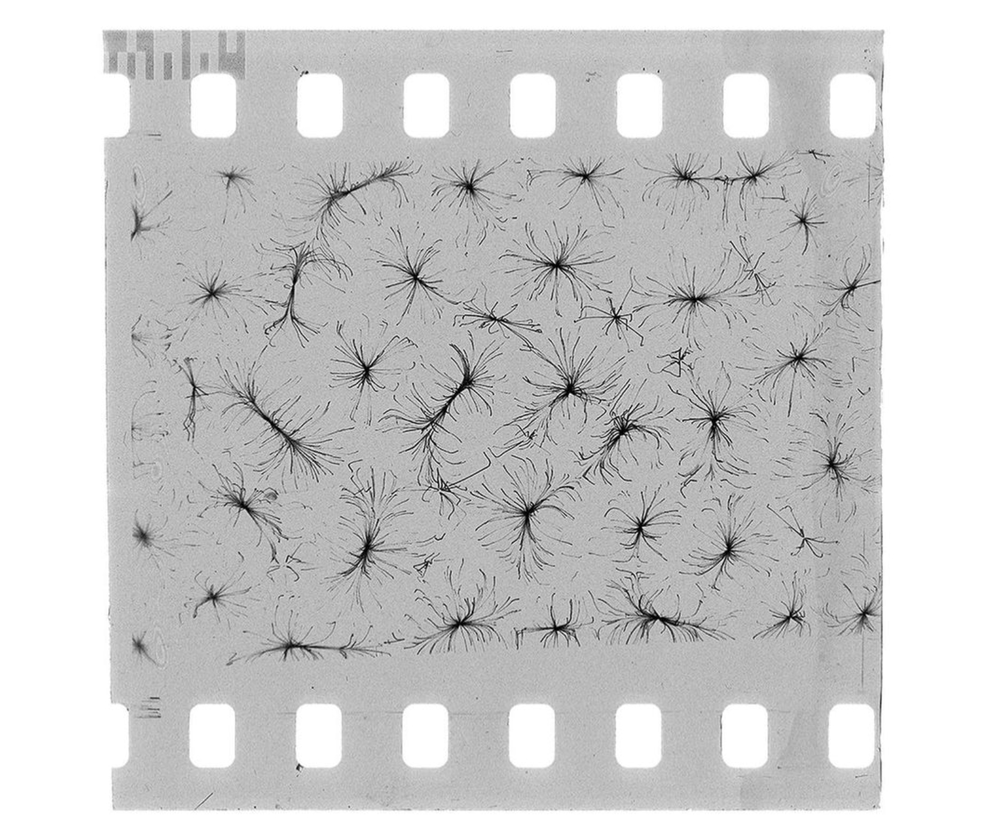

La resolución químicamente infinita de la emulsión y el atractivo de entender y diseñar una forma de trabajo y reproducción fueron los primeros intereses del proyecto. ¿Cómo optimizar este proceso? ¿Cómo aprovechar al máximo sus alcances y limitaciones? ¿Cómo transferir movimiento a un medio estático? 

## Digital-to-film-to-digital

En el auge de las criptomonedas y los NFTs, comencé a producir mucho material para subir y vender en los sitios de venta de criptoarte, y encontré en esta técnica propia un potencial particular. Como se explicó anteriormente, los NFT tienen la particularidad de quedar vinculados a las cadenas de bloques de la Blockchain "permanentemente", lo que los hace simbólicamente resistentes al paso del tiempo, mientras existan internet y las computadoras. Y si bien el propósito y trasfondo comercial de esos tiempos de burbuja e incertidumbre económica no son interés de la tesis, sí lo es la hibridez que implicaba convertir algo analógico a digital, re-digitalizarlo, luego procesarlo y multiplicarlo en las "cadenas de bloques".

Para transferir algo digital a fílmico primero hay que definir la unidad mínima en una película, y eso es el fotograma. En el caso de los rollos comerciales de 36 fotos, la unidad es la exposición. Por lo tanto, lo primero que hay que hacer en la computadora es traducir lo que se quiera transferir a un formato discreto, fragmentado y visual. En el caso de un GIF o un video, hay que separar la animación en fotogramas independientes, y en el caso de un programa que dibuja como puede ser el caso de algún sketch generativo realizado en _Processing_, hay que guardar cada "dibujo" por separado: esto puede hacerse capturando la pantalla como si fuera un video o avanzando y pausando la progresión del dibujo.

Definida esta fragmentación de la animación, se coloca una cámara 35 mm frente al monitor, en total oscuridad, con un lente largo para evitar aberraciones, y lo más perpendicular a la imagen. Se hace foco, se dispara la foto, se avanza el fotograma en la computadora y se repite el proceso. Es importante tener en cuenta que la imagen digital debe estar invertida para obtener un negativo "positivado" sin tener que recurrir a rollos de diapositiva o procesos de laboratorio más complejos.

En el caso de esta primera iteración, se hicieron un par de pruebas a partir de programas generativos escritos en _Processing_, como también una prueba a partir de una animación 3D. En el caso de la animación 3D se realizó una serie de transformaciones antes de la transferencia a fílmico: primero se renderizó el modelo y en segundo lugar se redujo en colores y resolución a una animación en formato GIF monocromática.

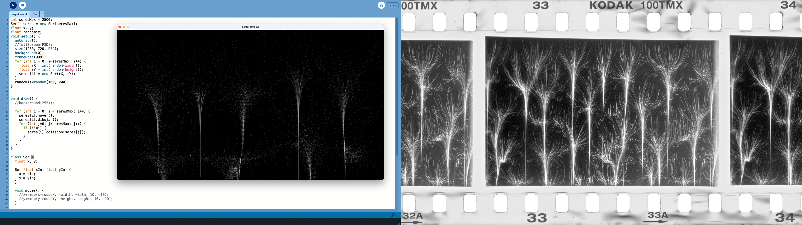

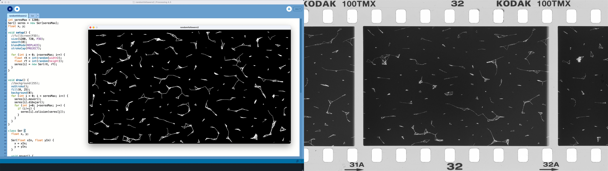


El proceso de laboratorio fue más bien sencillo porque se trató de película blanco y negro con revelador Kodak D76, y al fotografiar imágenes con los colores invertidos se revelaron en positivo sin la necesidad de hacer procesos de diapositivas. Una vez obtenido el material analógico se procedió a la digitalización. En este caso se utilizó la misma técnica de _Henrietta_, que utilizaba un escaner EPSON v600, con la particularidad de soportar transparencias, como diapositivas o rollos. Podían digitalizarse hasta 3 fotogramas a la vez. El proceso posterior ocurrió en After Effects: cada escaneo ocupaba 3 fotogramas de la línea de tiempo, y en cada uno de ellos una pequeña traslación horizontal que generaba finalmente la ilusión de movimiento. Esta transformación fue aplicada a todos los grupos de imágenes secuencialmente, y por último se aplicó una estabilización general basada en las perforaciones del film, lo que generó un movimiento estable.


Y como bien se describía al comienzo de este apartado, eran tiempos de NFT y muchas de las obras terminaron en los _marketplace_ de la _blockchain_, donde coleccionistas y especuladores gastan sus activos en obras de arte. Cuando un artista sube una pieza puede definir el número de unidades de la edición (por ejemplo, 15 copias), o establecerla como una copia única, aumentando su valor simbólico. Cuando un coleccionista compra una obra se transfiere la autenticidad de la obra al comprador, pero no necesariamente los derechos de uso. No se transfiere la exclusividad ni la autoría, solo la propiedad de esa "copia" en particular. El comprador puede volver a vender la obra a otro coleccionista y usufructuar el valor, y en muchos casos el autor original obtiene un porcentaje de esta nueva compra, pero esto depende del contrato del _marketplace_.


## Digital-to-film

Esta segunda iteración consistió en aprovechar el formato 35 mm en su dimensión física, sin volver a digitalizar las imágenes. La película en 35 mm es un standard practicamente universal, y la película de las cámaras fotográficas convencionales es la misma que la de las cámaras o los proyectores de cine (aunque la orientación es diferente: las cámaras de fotos trasladan la película horizontalmente y las de cine verticalmente, resultando la primera en mayor resolución pero la segunda en más fotogramas por metro).

Así como los hermanos Whitney se aprovechaban de chatarra militar de descarte para desarrollar sus computadoras mecánicas, Los Films Automáticos también utilizan equipos de descarte: cámaras reflex heredadas y proyectores de diapositivas olvidados. Aprovechando el formato en 35 mm y un poco inspirado en la forma de reproducción cíclica de los GIF, se recurrió a un famoso modelo de proyector de Kodak, el _Kodak Carousel,_ que lleva cartuchos de diapositivas circulares que giran indefinidamente. El _Carousel_ es muy recordado por su aparición en la serie norteamericana Mad Men, cuando el publicista Don Draper vende el nuevo nombre del producto a Kodak, quienes estaban muy aferrados a la idea de "rueda" del proyector y querían incorporarlo de algún modo a la campaña publicitaria. Draper, en cambio, no convencido con el nombre, explicaba que la nostalgia es "el dolor de una vieja herida", y que el proyector es en esencia una máquina del tiempo. "Va hacia atrás, hacia adelante, y nos lleva a un lugar al que anhelamos volver. Nos permite viajar como viaja un niño. Dando vueltas y de regreso a casa, a un lugar donde sabemos que somos amados. No se llama _La Rueda_. Se llama _El Carrusel_" [@weinerWheel2007].

Es interesante señalar que en esta escena se revela cómo la nostalgia, y especialmente la nostalgia catalizada por imágenes, puede ser parte de una idealización. Las diapositivas que muestra Don durante el pitch en esta escena muestran imágenes de su familia como la familia nuclear perfecta, una realidad que nunca vemos en el programa. Las imágenes crean nostalgia por un pasado que nunca existió. Hoy en día los académicos definen la nostalgia de una manera mucho más amplia que el anhelo original por un lugar; también comprende el anhelo por un tiempo específico que se pierde y se construye nostálgicamente en contraste con el presente. Ese antes que se ha perdido se considera superior a lo que se ha convertido en el hoy [@menkeSeekingComfortMedia2017].

El papel de la nostalgia es un punto importante, si se considera también _Henrietta_, _Cuando más se conecta menos se conecta_, o cualquier obra de _found footage_, donde hay una vuelta espiritual y tecnológica a momentos, ideas y estilos. Hay distintos mecanismos que pueden generar nostalgia durante la interacción con los medios, pero el caso de estos ejemplos de producción propia se acerca más a la idea de "nostalgia mediática", en contraposición a la "nostalgia mediatizada". En la nostalgia mediática, la cultura, la tecnología o el contenido de los medios están en el centro del anhelo nostálgico. La nostalgia mediática es, por lo tanto, nostalgia hacia los medios, mientras que en otras formas de procesos nostálgicos, los medios sirven sólo como mediadores o portales a experiencias del pasado no relacionadas con los medios, lo que entonces se denomina "nostalgia mediatizada" [@menkeSeekingComfortMedia2017].

Desde lo personal, el uso del Carousel para la obra puede despertar en muchas personas esta idea de nostalgia mediatizada porque está directamente vinculada a la idea de hogar y recuerdos familiares. Pero el eje central en estos experimentos está más cerca de la nostalgia mediática y del papel privilegiado que tenemos los artistas, viviendo en un tiempo transicional de unión entre cultura y tecnología, donde desarrollamos nuestros dispositivos, hackeamos los existentes, y reflexionamos sobre las ventajas creativas en las limitaciones tecnológicas. David Rokeby escribe que muchos artistas ("interactivos" en su caso, pero quizás también válido para artistas multimediales) "crean sus propias interfaces. Sin las restricciones y presiones implícitas en la obtención de un producto vendible y confiable 'para el mercado', son libres de incorporar una complejidad y ambigüedad más rica en esas interfaces". Rokeby agrega que, "mientras los ingenieros se esfuerzan por mantener una ilusión de transparencia en el diseño y refinamiento de las tecnologías mediáticas, los artistas exploran el sentido mismo de la interfaz, utilizando las diversas transformaciones del medio como su paleta" [@rokebyEspejosTransformantesSubjetividad2001].

Reemplazando la palabra "interfaz" por "dispositivo" podemos seguir el ejemplo de Rokeby y diseñar un sistema propio basado en tecnologías en desuso. Como las ideas de conservación evolutiva de Lino García Morales, a modo de "transformar para preservar", el primer paso consistió en convertir el proyector a LED, para evitar el desgaste de las lámparas originales de Wolframio. Para esto se compró un driver LED que convierte la corriente y la tensión original del proyector, y se instaló un LED cálido de 30w con un pequeño disipador de calor.

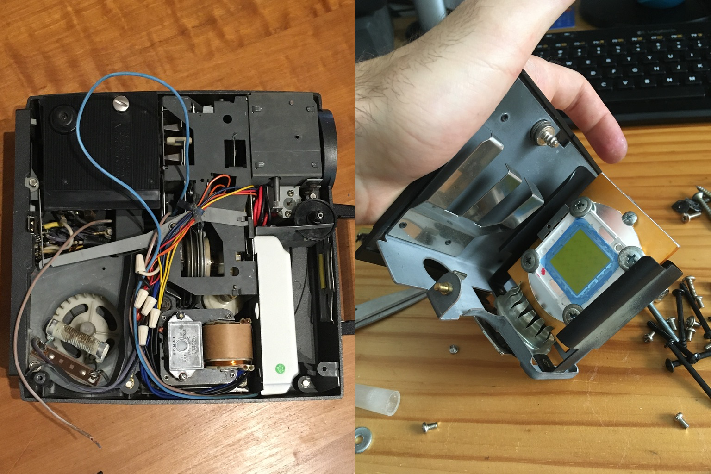

El segundo paso consistió en la automatización. Estos proyectores suelen venir con un control remoto, cableado, que avanza y retrocede las fotos. También suelen tener un modo "automático", como es el caso del modelo 800. El problema es que el automático es lento y el control remoto requiere de una persona que lo accione. Aquí entró en escena entonces el Arduino, una placa electrónica de hardware libre que utiliza un microcontrolador programable con una serie de salidas y entradas que permiten establecer conexiones entre el controlador y sensores, luces, motores, botones, interruptores, etc. El Arduino era alimentado por la fuente de 30v del proyector y reducida a 12v por una fuente _Step-down_. La idea era que la placa encendiera y apagara un _relé_, que se trata de una compuerta electromagnética que abre y cierra el paso de electricidad. En este caso se utilizaba para hacer de botón de "control remoto". De esta manera se logró presionar el botón lo más sincrónico posible, y lo más rápido que el proyector podía soportar. También se le incorporó un sensor de luminosidad en el lente para detectar cuando la lámpara estaba proyectando y cuando no, en pos de agilizar la comunicación entre el proyector y el Arduino.

Para esto también se experimentó con distintas animaciones realizadas en computadora, desde programas generativos hasta la animación de _El Faro_ mostrado anteriormente, el cual al ser un movimiento sencillo de rotación podía verse más apreciado en el lento movimiento del Carousel. Este pequeño video tiene una estética monocromática y de baja resolución, lograda a partir de un algoritmo de compresión conocido como _dithering_ (literalmente "entramado"), que consiste en reducir la cantidad de colores en una imagen y por diferentes relaciones de distancia y proporciones generar la ilusión de color aprovechando las falencias y capacidades del ojo humano de resolver formas, tonos y pigmentos. El dithering tuvo un renacer importante en los últimos años por la estable presencia nostálgica de los GIF en internet y la comunidad de videojuegos, pero en particular a partir del exitoso juego _Return of the Obra Dinn_ de Lukas Pope. El desarrollador _Surma_ cita a Pope en su artículo _Ditherpunk_ y explica a partir de una imagen del juego que el dithering es una técnica para ubicar pixeles usando pocos colores de una manera inteligente para engañar a tu cerebro para que vea muchos colores. Como en el juego, donde probablemente sientas que hay múltiples niveles de brillo cuando en realidad solo hay dos: brillo total y negro [@surmaDitherpunkArticleWish2021]. _Return of the Obra Dinn_ está realizado en monocromo, un retroceso a las limitaciones técnicas del Macintosh y otras computadoras de la época. En el juego incluso se puede cambiar entre varios esquemas de colores icónicos en el menú de opciones, desde la Commodore 64 teñido de azul hasta el negro intenso de un monitor IBM 8503 y el ámbar de un Zenith ZVM 1240. Inspirado en esta estética en _El Faro_ se buscó la nostalgia de épocas digitales pasadas, problematizadas con el contraste analógico del film que también genera una reflexión sobre el computer art de los años 60.

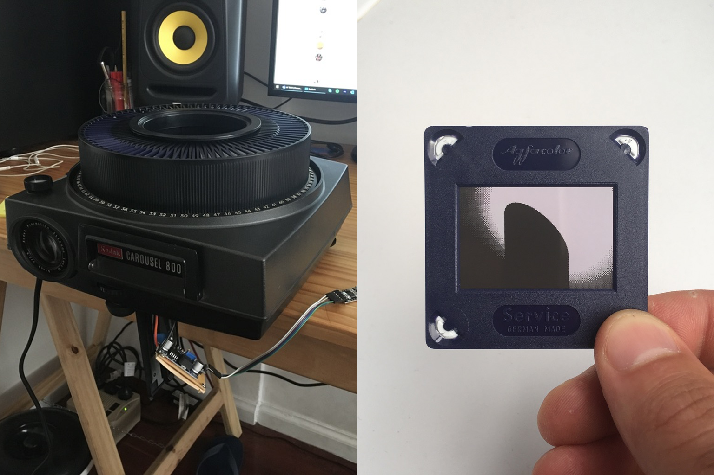

El dispositivo llegó a montarse y registrarse en cheLA en 2023, y sirvió como antecedente a la tercera iteración. Pero el problema principal fue la falta de potencia de luz comparado con las lámparas originales, y la poca velocidad de la proyección como para siquiera aludir a una ilusión de movimiento. También parecía que todo el proceso pecaba de estar "sobre-ingenierizado", con demasiados pasos y sensores, pero con un resultado lejos del esperado[^17].


## El Archivo del Film Automático

Para esta nueva etapa de la obra, en un primer momento se decidió enfrentar el problema de la velocidad de obturación del dispositivo proyector. Una nueva idea consistía en conseguir al menos 4 proyectores y controlar las obturaciones a través de un Arduino, que sincronizaría cada Carrusel de manera tal de conseguir al menos 4 fotogramas de visualización por segundo, siendo que la velocidad máxima de cada proyector es de más o menos una foto por segundo. La primer prueba se hizo con 2 proyectores y fue bastante exitosa.


Pero más allá de la metáfora simbólica o de los tecnicismos que se venían investigando en iteraciones anteriores, en este momento de la investigación surgieron nuevas preguntas: ¿Qué mostrar? ¿Por qué proyectarlo? A partir de todo lo investigado, convertir una obra de arte digital a fílmico y que esta pierda justamente su carácter "digital" no parecía la mejor manera de preservar en el tiempo una obra de este tipo. ¿Cómo hablar entonces de la hibridez, de la transición y de las impurezas que se estudian en la tesis?

### En búsqueda de una permanencia digital

En el apartado de _Computadoras y Celuloide_ se menciona brevemente el proyecto del _Arctic Code Vault_ de _Github_, una odisea de preservación digital que consistió en hacer un _backup_ de todos los repositorios y programas de código abierto almacenados en esa plataforma hasta el 2 de febrero de 2020 y transferirlos ópticamente a material fílmico en forma de píxeles blancos y negros, para almacenarlos en el _Arctic World Archive_ (Archivo Mundial del Ártico), un archivo emplazado en una vieja mina de carbón del Polo Norte en el permafrost del archipiélago de Svalbald, en Noruega. El AWA, además del código abierto de GitHub, contiene información histórica y cultural de varios países, con una expectativa de vida de 500 a 2000 años, almacenado en las condiciones adecuadas.

En esencia, un archivo digital está compuestos de código binario: combinaciones de unos y ceros. Apoyados en la tecnología de la empresa _Piql_, _GitHub_ logró codificar toda su base de datos en miles de fotogramas de 8.8 millones de píxeles cada uno, con ciertas restricciones basadas en el mérito de cada repositorio (archivos "binarios" de más de 100 kb eran descartados a menos que sus repositiorios tuvieran más de 250 "estrellas", el sistema de puntuación del sitio). Para una mejor densidad e integridad de los archivos, la mayoría de los datos se almacenaron codificados y comprimidos en códigos QR. Un índice y una guía legibles por humanos que se encuentran en cada carrete explican cómo recuperar los datos. El backup del 02/02/2020, que consta de 21 TB de información, fue archivado y transportado al Ártico en 186 carretes de película [@evansGithubArchiveprogram2024].


En el mismo apartado de _Computadoras y Celuloide_ se menciona el proyecto de Alisina Bahadori _Paperify_ que convierte cualquier tipo de archivo digital en una secuencia de códigos QR adaptados a páginas A4 listos para ser impresos y resguardados. Como se mencionó en ese apartado, un código QR convencional admite hasta 177x177 pixeles, aproximadamente 4000 caracteres con los que trabajar, que equivalen a 3 kb de información. El proyecto de Bahadori es parecido a cuando se instalaban programas o juegos en los años 80 y 90 donde muchas veces eran necesarios varios discos que eran solicitados por la computadora secuencialmente durante la instalación. En este caso es igual pero con papel. Bahadori hace uso de una librería llamada _qrencode_ que divide un archivo en los fragmentos necesarios para que cada QR almacene una parte de 3 kb del todo. Si tuvieramos que codificar los 21 TB de información del Arctic Code Vault de Github, tendríamos que generar e imprimir 7 millones de páginas A4 con el código QR correspondiente.

Pero lo interesante de esta tecnología es entender que existen conversiones y procesos híbridos que trascienden las abstracciones y metáforas informáticas y habitan nuestro mundo físico, y representan información digital sin la necesidad de utilizar electricidad. Y con las condiciones e instrucciones adecuadas, pueden ser decodificadas, recuperadas y preservadas en el tiempo.

En toda esta serie de reflexiones e idas y vueltas se propuso emplear esta tecnología limitada de codificación como materia prima para la iteración final de la tesis. Con la preservación a futuro en mente y un poco inspirado por el desafío, se buscó trabajar con las siguientes condiciones y limitaciones: 

- Inspirado en los referentes de la tesis, la obra debía ser una animación digital. Para mayor transparencia la obra debía estar generada en código.
- Para mayor permanencia, el código debía estar generado en software de código abierto.
- Con los 2 proyectores Kodak en mente, la animación tenía que estar formada por 160 fotogramas.
- Con los códigos QR en mente, cada fotograma tenía que ocupar menos de 3 kb. Cada QR tenía que poder contener el código fuente y el fotograma correspondiente.
- Y finalmente, con el espectador en mente, una computadora tendría que decodificar en tiempo real los QR que se proyectan.


### Desafíos y limitaciones

Cuando se renderiza una imagen digital, cuando se completan los cálculos y procesos de luz, color y movimiento para terminar en una imagen plana, nos referimos a gráficos rasterizados, también conocidos como imágenes de píxeles. La renderización es el proceso de generar una matriz rectangular o una cuadrícula de colores, a partir de modelos 3D o datos matemáticos, y es visible a través de pantallas de computadora, papel u otros medios de visualización. Los formatos de archivo más comunes para este tipo de imágenes incluyen JPG, PNG, TIFF, GIF, entre otros. Al renderizarse, las imágenes pasan de la placa de video y el procesador para ocupar espacio en la memoria de la computadora. Se habla frecuentemente de "imágenes en tiempo real" cuando el proceso de renderización ocurre instantáneamente y se muestra en una pantalla sin necesidad de ser guardado como gráfico rasterizado. Por otro lado, existe otro tipo de imagen digital, incluso anterior en términos históricos a esta tecnología: el gráfico vectorial. Este tipo de imagen consiste en una serie de coordenadas de puntos unidos por líneas, y es muy utilizada en programas como Illustrator o Autocad. A diferencia de las imágenes rasterizadas, en las imágenes vectoriales no hay una cuadrícula de píxeles uniforme. Como se trata de una serie de instrucciones relativas, las imágenes vectoriales son escalables, lo que significa que pueden ampliarse o reducirse sin perder calidad. Además, las imágenes vectoriales ocupan menos espacio de almacenamiento en comparación con las rasterizadas, lo que las hace ideales para ciertos tipos de gráficos, como logotipos y ilustraciones.

La primera limitación que saltó a la vista fue que es muy difícil que un fotograma rasterizado ocupe menos de 3 kb, a menos que se trate de una imagen muy pequeña. Por lo tanto se llegó a la conclusión que lo mejor sería exportar cada cuadro en un formato vectorial. Uno de ellos es el SVG, (_Scalable Vector Graphics_), un formato de archivo de imagen vectorial que a diferencia de los formatos de imagen rasterizados como JPEG o PNG que almacenan datos de imagen píxel por píxel, utiliza fórmulas matemáticas y coordenadas para describir formas y trazos. Esto permite que las imágenes resultantes se puedan escalar a diferentes tamaños sin perder calidad, y lo más importante, pueden ser representadas por números y letras, y ocupan mucho menos lugar en el disco (un archivo SVG es básicamente un archivo de texto).

Con estas limitaciones es interesante hacer un paralelismo con la escena de la _Demoscene_, una subcultura del mundo de las computadoras surgida en los años 80 basada en la creación de _demos_: unos programas ejecutables de computadora de muy bajo peso que reproducen presentaciones audiovisuales con el objetivo de demostrar la habilidad técnica de sus creadores. La escena surgió en plena proliferación del software pirata, cuando los técnicos violaban los sistemas de protección intelectual de los programas para distribuirlos ilegalmente y dejaban sus firmas en forma de audio y video en pequeños espacios de las memorias, con el objetivo de hacer conocer sus nombres y competir con otros "demosceners". Eventualmente la subcultura evolucionó a una escena dedicada exclusivamente al desafío de crear visuales en espacios de memoria reducidos. En un video digital convencional la computadora se encarga de reproducir fotograma a fotograma un contenido ya establecido, en cambio, en una _demo_, la computadora solamente se encarga de leer "la receta" almacenada en memoria para renderizar el material en tiempo real, y al tratarse de algoritmos y ecuaciones matemáticas en vez de millones matrices de píxeles y colores, la demo termina ocupando mucho menos espacio. Las demos participan en festivales llamados "demoparties", donde las categorías de competencia más típicas son las demos de 64k y las demos de 4K, donde el tamaño del archivo ejecutable está restringido a 65536 y 4096 bytes respectivamente.

Por otro lado, siguiendo con los paralelismos, en el capítulo de _Preservación descentralizada_ hacíamos mención a las posibilidades y limitaciones de los NFT "On-chain" almacenados directamente en la Blockchain. Un NFT "On-Chain" es un token no fungible cuyos datos y metadatos están completamente almacenados dentro de la cadena de bloques. Esto incluye no solo la información básica del NFT (como el título, descripción y propiedades), sino también cualquier código fuente o medio asociado. Este tipo de NFT asegura que todos los aspectos del token están totalmente descentralizados y sean accesibles mientras exista la cadena de bloques. Por varias limitaciones técnicas (y económicas, ya que la modificación de la Blockchain siempre conlleva un costo monetario) no suelen superar los 30 kb de peso, y se tratan de secuencias de caracteres (incluso si son imágenes o videos, estas son convertidas a _base 64_[^18]). Esto también fue una fuente de inspiración para la idea técnica porque se basa en un principio de preservación y descentralización: las limitaciones traen beneficios en la permanencia de las obras.

La idea técnica parecía funcionar, pero la pregunta seguía existiendo... ¿Qué proyectar? ¿Qué preservar? Ya de vuelta en la computadora, un poco inspirado en el _ReCode Project_ que se menciona en el apartado de _Los Medios Variables_, se buscó inspiración y dar tributo a los maestros y maestras del arte por computadora. Como se explicó entonces, la idea fundamental de esa plataforma online es recrear de forma colectiva y abierta obras hechas por computadora con lenguajes de programación contemporáneos a partir de documentación de archivo. Entre toda esta documentación se pueden encontrar muchas obras de científicos e ingenieros de _Bell Labs_. Los _Laboratorios Bell_ apadrinaron a varios de los más importantes exponentes del arte por computadora, como Michael Noll, Edward E. Zajac (autor de la primera animación digital por computadora de la historia en 1963), Frank Sinden y Kenneth Knowlton.

Michael Noll (1938) es un ingeniero y artista norteamericano pionero del arte por computadora por sus trabajos en estos laboratorios durante los años 60. Noll, junto a los pioneros alemanes Frieder Nake y Georg Ness fueron los primeros en exhibir públicamente obras de arte por computadora y acuñar en esa ocasión la idea de _computer art_. Una de sus obras más recordadas es _A computer generated ballet_ (1965), un "programa coreográfico" de 2 minutos y medio donde 6 bailarines realizan coordinados movimientos de danza. Como casi todas las obras digitales de la época, estos trabajos eran transferidos fotográficamente a película para su exhibición. Lo interesante es que en Bell Labs no surgieron como herramientas de expresión artísticas, sino como de visualizaciones científicas y de ingeniería. El mismo término "computer art" surgió como una broma en los laboratorios, Michael Noll cuenta que un colega (Elwyn Berlekamp) cometió un error de programación que produjo un desorden gráfico en el plotter, lo que cómicamente llamó "computer art". Inspirado, Noll decidió programar la computadora para crear arte deliberadamente, basándose en su formación anterior en dibujo y su interés por la pintura abstracta. Años más tarde, estimulado por el arte óptico creó _Ninety Parallel Sinusoids_ como una versión por computadora de la obra _Currents_ de la aritsta británica Bridget Riley. Noll creía que en la computadora el artista tenía un nuevo compañero artístico, y quería demostrar con qué facilidad una computadora podría ser programada para crear este tipo de arte, que hoy podría llamarse programático o generativo [@nollFirstHandEarlyDigital2016].


La recreación literal en código no presentó muchos inconvenientes, y consistió en dibujar noventa trayectorias basadas en el seno de un ángulo creciente multiplicado por la posición horizontal de la pantalla. Es interesante comprobar lo que planteaba Noll en 1965 con respecto a la facilidad e las computadoras para llegar a estos resultados.
```java
float x=20;

void setup() {
  size(600, 600);
  background(255);
}

void draw() {
  for (int i=0; i<90; i++) {
    pushMatrix();
    float freq = map(x, 0, 600, 6, 24);
    float y = sin(x/freq)*15;
    translate(0, y);
    point(x, (i*6)+30);
    popMatrix();
  }
  if (x<width-20) x++; else noLoop();
}

```


En línea con esta trayectoria, y siguiendo las limitaciones propuestas, se redujeron las líneas a lo mínimo para ensayar la reducción a formato SVG vectorial, ya que Processing permite la exportación en este tipo de archivo. Como no era posible almacenar 90 curvas sinusoidales en solamente 3 kb de texto, se llegó a un resultado muy minimalista de la obra, que se fue desviando del camino original de Noll, hasta que accidentalmente se empezó a parecer a una tira de película. Después de algunos retoques, se llegó a una animación de 160 cuadros, y que cada fotograma SVG ocupe el máximo posible, 3 kb. La animación es un tributo y una "carta de amor" a la película de 35 mm, gran protagonista de esta tesis, y la forma de la película es para hablar de la transición digital/analógica, de pasos discretos y caóticos a curvas suaves y orgánicas[^19].


El paso siguiente consistió en la codificación a su formato QR. El uso más común de este código es para páginas web, es muy frecuente en los bares y restaurantes escanear un código QR para consultar el menú. Esto es porque la decodificación de los píxeles negros y blancos resulta en una serie de caracteres en forma de texto que forman una página web. Pero como ya bien dijimos, mientras ocupen menos de 3 kb, uno puede codificar cualquier texto en el código, no necesariamente una dirección web, y un SVG es un archivo de texto. Si uno quisiera guardar una imagen rasterizada en un QR, tendría que primero codificar el archivo binario a formato BASE64 que convierte unos y ceros a texto.

El objetivo principal era que cada QR contenga la ilustración en formato SVG, pero que además incluya de algún modo el código fuente de la animación, y también el link a la versión online. Si quien accede a esta obra, no tiene internet, puede reconstruir la animación con el código fuente, o bien visualizar el archivo SVG en cualquier explorador de internet. Para todas estas posibilidades se armó un repositorio en Github con varias herramientas útiles personalizadas para este fin[^20].

Había un problema. Los programas como Ilustrator o Processing exportan ilustraciones SVG con demasiados caracteres, con el objetivo de ser de fácil lectura para las personas. Para lograr archivos por debajo del límite de 3 kb se comprimió el archivo SVG al mínimo. Esto se logró con el sitio web _compress-or-die.com_, que entre varios métodos de compresión, utiliza la librería _svgo_[^21].

Una vez solucionado el tema del peso, se comenzó a diseñar la información oculta a incrustar en cada fotograma. Por fortuna, un archivo SVG puede contener "comentarios", es decir, grupos de texto que no forman parte del código ejecutable y que en general son utilizados para comunicar mensajes humanamente legibles. Este recurso se aprovechó para estructurar cada fotograma SVG de la siguiente manera: primero la meta, en forma de comentario, y finalmente el contenido del archivo SVG propiamente dicho (lo interesante es que este contenido puede leerse como una URL convencional en cualquier explorador como Google Chrome o Firefox si se le agrega "data:image/svg=xml" antes de "<svg..."). Cada fotograma SVG fue codificado a QR a través de la librería _qrencode_, y puede ser decodificado a través de la librería _zbarimg_.

Y así surgió la idea del _Archivo del Film Automático_ (con siglas _AFA_), un archivo ficticio e imaginario, que forma parte de una suerte de ficción donde nos planteamos formas alternativas de salvar obras digitales. A través de _Los Films Automáticos_, esta serie de experimentaciones diversas de almacenado digital en soportes analógicos, nos dedicamos insistentemente a la búsqueda de la permanencia en obras de arte digital.

A continuación, un ejemplo reducido de cada QR:

```html
<!-- AFA_0001.svg
Archivo del Film Automatico
editor.p5js.org/AFA/full/gMMd7vZn9
Javier de Azkue 2024

SOURCE CODE
function setup(){createCanvas(384,240);}function draw(){background(0);translate(0,35);stroke(255);noFill();let w=width,t=millis(),min=0.1,max=3,offset=-11;t=t/430.0;for(let i=30;i<=height-110;i+=10){beginShape();for(let x=0;x<=w+6;x+=2){let frq=map(x,0,w,min,max),y=sin((x/frq)+t)*15,frac=6;if(x>w/2)frac=12;if((i<50||i>110)&&x%frac==0){vertex(x,y+i);}if(x>0&&i>30&&i<50){if(x%140==0){let x2=x+offset,frq2=map(x2,0,w,min,max),y2=sin((x2/frq2)+t)*15;line(x2,y2+i,x2,(y2+i)+80);}}if((i==130||i==40)&&int(x/10)%2==0){{if(x>w/2-x/2&&x<w+5){if(x%5==0){let x2=x-3+offset,frq2=map(x2,0,w,min,max),y2=sin((x2/frq2)+t)*15;line(x2,y2+i,x2,(y2+i)-10);x2=x+3+offset;frq2=map(x2,0,w,min,max);y2=sin((x2/frq2)+t)*15;line(x2,y2+i,x2,(y2+i)-10);}}}}}endShape();}}

URL+SVG
data:image/svg+xml,<svg... --> <svg xmlns="http://www.w3.org/2000/svg" viewBox="0 0 384 240"><path d="M0 0h384v240H0z"/><g fill="none" stroke="white"><path d="m0 64 6 8.4 6-10.1 6-9.6 6 20.4 6 2.9 6-18.4 6 4.3 6 5.7 6 3.4 6-20.8"/></g></svg>
```


A diferencia de las versiones anteriores donde se convertían a analógico obras digitales a través de la fotografía y el soporte fílmico, en el _Archivo del Film Automático_ la búsqueda se centraba en conservar la cualidad digital de cada fotograma de una forma física y material. La codificación visual que se obtiene de este proceso no es legible por los humanos pero sí decodificable por las máquinas. La obra es un diálogo contradictorio de preservación y rescate, que busca ilustrar la fragilidad de los medios digitales, así como también la robustez de las máquinas mecánicas y el soporte fílmico.

La comunicación entre el par de proyectores sincronizados y la computadora es relativamente sencilla. Se escribió un programa en Python que captura imágenes a través de una cámara mirrorless y decodifica los QR proyectados, que son "ingestados" en Google Chrome en formato SVG[^22] en tiempo real. Esto es posible gracias a que a través de una URL uno puede escribir el código del SVG y Google Chrome lo carga como una página web. El programa en Python captura las imágenes con la librería _OpenCV_, pero decodifica los QR a través de otra librería llamada _pyboof_, que funciona "encapsulando" ("wrapping" en inglés) la librería _BoofCV_, basada en el lenguaje de programación Java. Este paralelismo de lenguajes facilita mucho la velocidad de interpretación de los QR ya que las labores de captura e interpretación se reparten entre procesos independientes.

Este proceso digital de visión por computadora y decodificación es independiente de la automatización de los proyectores. En su mayoría los proyectores de diapositivas vienen con un control remoto cableado desde el cual uno puede avanzar y retroceder las diapositivas. Para la sincronización con Arduino se aprovechó este mecanismo, enchufando los cables directamente a unos relés en el Arduino que se abren y cierran de forma sincronizada, simulando la acción de avance del control. Esto permitió una modificación no invasiva de los proyectores. Al mismo tiempo, se tuvo que abrir y desactivar la función de autofoco ya que por la velocidad a la que se cambian las fotos el resultado es contraproducente. El proyector tiene un pequeño motor en el lente que ajusta el foco de acuerdo a un cálculo de distancia con el material fílmico, que en muchas ocasiones se dobla por calor o humedad. Para desactivarlo simplemente se desenchufó un polo del motor.

### La instalación

La obra en su despliegue espacial fue siempre pensada como una instalación, ya que en una forma puramente digital no comprendería toda la profundidad de formatos y soportes que se vienen estudiando. Es por eso que para su etapa instalativa se buscó diseñar un aparato que meditara sobre la caducidad, el ritmo, el tiempo, la permanencia, la automatización y, en la misma medida, en la preservación digital. Para enriquecer esta reflexión se optó por sumar una proyección digital a un costado del dispositivo para mostrar en loop las otras iteraciones de la investigación.

El registro y estreno de la obra se realizó en la ciudad de Montreal, Canadá, en el marco de la muestra colectiva _Composant Machinal,_ curada por Riad El Mahmoudy, donde formó parte junto a otras 5 obras de distintos artistas de la región[^23]. Esta muestra se dio en el contexto de la escritura de la tesis, lo que impulsó ampliamente el desarrollo de la obra[^24]


Como se explicaba anteriormente, la obra fue concebida como un videoinstalación, donde las diapositivas disparadas rítmica y secuencialmente son interpretadas en tiempo real por una cámara y decodificadas por una computadora. Pero al mismo tiempo se incorporó a la obra un video digital en loop de las experimentaciones anteriores, donde se puede ver el contraste entre las pruebas de _digital-to-film-to-digital_ y las diapositivas contenedoras de archivos digitales. En las primeras, los obras digitales son transformadas a material analógico, perdiendo su cualidad digital; mientras que en la obra final, a través de codificación y un sistema de recuperación, el carácter digital de la obra se mantiene a pesar de su nueva forma material.


El _Archivo del Film Automático_ es un ensayo de preservación digital inspirado en varios de los referentes artísticos y tecnológicos tratados en la tesis. La idea de perdurabilidad del trabajo se basa principalmente en los conceptos de documentación y transformación planteadas por Vanina Hofman en el apartado de _Los medios variables_. La animación digital preservada fotograma por fotograma en las diapositivas está inspirada en la conservación evolutiva de la que habla Lino García Morales, partiendo de la apropiación, transformación y reinterpretación de arte digital. Cada fotograma conserva de forma digital, pero representado de forma física, el código fuente, el número de fotograma, un link al código fuente en funcionamiento, y los nombres del proyecto y el autor. Pero también describe en lenguaje natural el nombre del proyecto y el nombre del archivo digital que representa. Luego, el traspaso a fílmico se basa en la experiencia heredada de los archivos cinematográficos, donde se comprueba la eficacia del material en la permanencia y la importancia simbólica de utilizar el formato 35 mm de más de 100 años de historia, aún hoy al a venta tanto en el campo amateur como profesional. El material fílmico, como el cine estructural, tiene además esa cualidad física que hace evidente su materialidad y transparente su funcionamiento. Al mismo tiempo, la obra viene acompañada de la tesina escrita, por lo que la documentación para la perdurabilidad es grande en este sentido, ya que no solo guarda instrucciones, códigos y funcionamiento, sino también contexto e investigación. En este sentido, representa una ventaja muy importante que sea el mismo artista quien documenta y conceptualiza estrategias de perdurabilidad en su propia obra. Finalmente, la serie por momentos también roza estrategias más contemporáneas y tecnológicas de preservación, con el uso de la _Blockchain_ y los _NFT_. Todos estas ideas acompañan conceptualmente la instalación, pero la obra en su forma instalada también ofrece una experiencia abstracta de luz, sonido y tecnología nostálgica que la abre a múltiples interpretaciones posibles.


# IV. Link a registro audiovisual

En búsqueda de preservar a futuro el registro audiovisual de la tesis, a continuación se incluyen dos links al mismo registro, uno a través de Youtube (centralizado) y otro a través de la _InterPlanetary File System_ (descentralizado)[^25]. Ambos son posibles de acceder a través de sus respectivos códigos QR.

**Link a IPFS**


[amber-magnificent-wolverine-333.mypinata.cloud/ipfs/QmZk2bwnLKgSEnQnhA9ecUkQuVEQU6s7Aq6jgTEkxC6j36](http://amber-magnificent-wolverine-333.mypinata.cloud/ipfs/QmZk2bwnLKgSEnQnhA9ecUkQuVEQU6s7Aq6jgTEkxC6j36)

**Link a Youtube**


[youtu.be/ty9RAt6egG4](http://youtu.be/ty9RAt6egG4)

# IV. Sin pedir permiso: un momento transicional

Del Amo Cuarón destacaba en _Clasificar para Preservar_ las bondades de rescatar materiales fílmicos dando acceso a ellos, mientras que Sandusky celebraba el uso de material de archivo de los cineastas del Archival Art Film que duplicaban y circulaban sin permiso imágenes que de otra manera serían descartadas o perdidas. Estas voces promueven distintas maneras de acceso al material como recurso de preservación. En este punto cabe recordar el caso de la colección amateur de películas de Manuel Peña Rodriguez, que en manos de instituciones y frente a adversidades y errores resultó tener la última copia completa de Metrópolis de la que se tiene conocimiento.

Hito Steyerl, por su parte, hablaba de una “imagen pobre”: las “copias en movimiento”. La imagen pobre “...transforma la calidad en accesibilidad, el valor de exhibición en valor de culto, las películas en clips, la contemplación en distracción. La imagen es liberada de las criptas del cine y los archivos y empujada a la incertidumbre digital a costa de su propia sustancia" [@steyerlDefensaImagenPobre2014]. Es interesante relacionarlo con Sandusky en tanto que promueve una distribución del material por fuera del sistema, por fuera de los intereses económicos. Copias por fuera del circuito comercial y legal, desautorizadas para su distribución: copias pirata, “screeners”, copias de mala calidad. En la dinámica de redistribución de Internet de Steyerl, los creadores independientes pueden subir y compartir sus obras y muchas perduran en el tiempo de forma automática, mientras los sistemas funcionen y se mantengan (basta con ver los ejemplos de Fotolog o Geocities, o formatos irreproducibles, actualizaciones de hardware sin retrocompatibilidad, páginas web caídas, links "podridos", sitios de guardado de archivos como Megaupload eliminados por cuestiones legales, codecs de video corrompidos, o simplemente bugs).

Steyerl hace referencia directa al video digital y a su distribución alternativa, pero lo destacable de todo el movimiento que describe aquí es la tecnología y las consecuencias culturales del mero uso de las plataformas secundarias de distribución. Del mismo modo que un usuario sube a _Youtube_ o al sitio ruso _ok.ru_ la filmografía completa de Chris Marker (como el ejemplo que Hito menciona en su escrito)… ¿No se podrían pensar a los NFT y a sus creadores como unas nuevas imágenes pobres, en cuanto a su distribución “permanente”, gracias a su apoyo en tecnologías descentralizadas como el IPFS y la blockchain?

En los apartados de soportes analógicos nos dedicamos a destacar las bondades y desafíos del material físico, y se encontró un punto interesante de hibridez en el cruce entre arte por computadoras con celuloide y con papel. En la inestabilidad de la preservación fílmica aprendimos que cada integrante de la familia de los medios variables requiere cuidados y proyecciones particulares para su permanencia en el tiempo, de los que surgen numerosas escuelas e instituciones con diferentes métodos y prioridades.

En los apartados sobre soportes digitales retomamos el reciclaje de material en internet, como el ejemplo de _Cameron's World_, y también cuestionarnos si la piratería, el exceso de imágenes, los remixes y los torrents forman parte de este mundo, en tanto que también reproducen material, o incluso lo preservan, por lo menos en términos de "lenguaje e ideas" como decía Lowenthal en _Material Preservation and Its Alternatives_. Fosatti describía en su libro _From Grain to Pixel_ los tiempos que corren como un momento "transicional", tanto que define al cine como una transición permanente entre analógico y digital, una eterna tensión entre el medio y el sentido, como el paradigma de los medios variables que mencionábamos en el apartado sobre ellos. La autora destaca el papel y la responsabilidad del archivista, que tiene la posibilidad de pararse en el momento transicional analógico-digital.

Sobre la responsabilidad del archivista, es interesante hacer una equivalencia con el papel del artista, que pareciera tener un rol también privilegiado en esta transición, a medio camino entre preservación y arte: "los artistas exploran el sentido mismo de la interfaz, utilizando las diversas transformaciones del medio como su paleta" [@rokebyEspejosTransformantesSubjetividad2001]. Es en esta línea del medio como paleta se llevó a cabo el desarrollo de los _Films Automáticos_, con la estética de la hibridez y las consignas de la permanencia como horizontes. Imágenes digitales transferidas a fímico, ilusión de movimiento recreado en dispositivos mecánicos en desuso, sistemas de codificación aprovechados para almacenar archivos digitales en medios físicos, y la experiencia de la instalación y el despliegue de los experimentos con el fin de comunicar este trayecto a un espectador. La obra es un proyecto de instalación que explora técnicas híbridas de arte por computadora y preservación física, combinando métodos digitales con procesos y formatos analógicos. Concebido como una carta de amor al formato cinematográfico de 35 mm, el proyecto utiliza animación procedural, proyectores de diapositivas automatizados y _computer vision_ para reflexionar sobre la conservación de las imágenes y los desafíos de la preservación de arte digital.

Sin embargo, para terminar, y quizás a modo de advertencia, si bien venimos describiendo resultados beneficiosos en la preservación accidental y automática, es importante recordar que la verdadera permanencia ocurre con intención, con compromiso con la obra y el autor, y con conciencia ecológica y tecnológica. Es importante conocer la materialidad, entender los riesgos tecnológicos y temporales a través de la experiencia, y también, siempre con cuidado, dejar lugar a la experimentación y a la hibridez, en todos los sentidos posibles, con el objetivo de generar diálogo, concientización y acceso. Como si habláramos de un trabajo manual y consciente contra sistemas automáticos y obsolescencia programada, en este momento "transicional" que describe Fossati, los artistas y archivistas contamos con tantos privilegios como responsabilidades y desafíos en lo que queda de la historia.

# V. Glosario

**4K**: Estándar de resolución de video de casi 4000 píxeles de ancho (3840 × 2160).

**After Effects**: Un software de posproducción de video utilizado para crear efectos visuales y gráficos en movimiento.

**Arduino**: Una plataforma de prototipado electrónico de hardware de código abierto que se utiliza para crear dispositivos interactivos.

**Bitcoin**: La primera criptomoneda descentralizada, concebida en 2008 y lanzada en 2009 por una persona o grupo de personas bajo el seudónimo de Satoshi Nakamoto.

**Blockchain**: Una tecnología de registro distribuido que permite la creación de una especie de libro de contabilidad digital compartido y seguro para registrar transacciones en una red descentralizada.

**Bug**: Un defecto o error en un programa de computadora que causa un comportamiento inesperado o incorrecto.

**Cardano**: Una plataforma blockchain de código abierto basada en _Proof of Stake_ (PoS), un protocolo de consenso utilizado en blockchain para validar y procesar transacciones. A diferencia del _Proof of Work_ (PoW), que se utiliza en redes como Bitcoin, donde los nodos de la red compiten entre sí para resolver problemas matemáticos complejos y así validar bloques y recibir recompensas, en PoS los nodos son seleccionados para validar bloques basándose en la cantidad de criptomonedas que poseen y están dispuestos a "apostar" como garantía.

**Commodore 64**: Una popular computadora doméstica lanzada en 1982 conocida por su amplia biblioteca de juegos y su influencia en la industria de la computación personal.

**Crowdsourcing**: El proceso de obtener ideas, servicios o contenido al solicitar contribuciones de un gran grupo de personas, generalmente en línea.

**Datacenters**: Instalaciones físicas que albergan servidores y otros equipos de tecnología de la información, utilizados para almacenar, procesar y distribuir datos.

**Ethereum**: Una plataforma blockchain de código abierto que permite a los desarrolladores construir y desplegar contratos inteligentes y aplicaciones descentralizadas. Su criptomoneda nativa es el Ether.

**Flash**: Una plataforma multimedia desarrollada por Macromedia (adquirida por Adobe) utilizada para crear animaciones interactivas, juegos y aplicaciones web.

**Floppy disk**: Un medio de almacenamiento de datos magnéticos que fue ampliamente utilizado en la década de 1980 y 1990 para almacenar y transferir información.

**Fotolog**: Una plataforma de blogging de fotos que fue popular en la década de 2000, permitiendo a los usuarios publicar y compartir fotos con comentarios.

**Geocities**: Un servicio de alojamiento web que permitía a los usuarios crear sus propias páginas web personales, muy popular en los años 90 y principios de los 2000.

**GIF**: Formato de archivo de imagen que admite animaciones y se utiliza ampliamente en la web.

**Github**: Una plataforma de desarrollo colaborativo para alojar proyectos utilizando el sistema de control de versiones Git.

**Hash**: Una función matemática que convierte una cantidad de datos en una cadena alfanumérica fija de longitud fija, utilizada en criptografía y blockchain.

**HTML**: Lenguaje utilizado para crear y estructurar páginas web.

**IPFS**: InterPlanetary File System, un protocolo de red y sistema de archivos descentralizado diseñado para crear un Internet más resistente y distribuido.

**Inteligencia Artificial**: Campo de la informática que se ocupa del desarrollo de sistemas capaces de realizar tareas que normalmente requieren inteligencia humana.

**Javascript**: Un lenguaje de programación de alto nivel utilizado principalmente para crear contenido interactivo en páginas web.

**Java:** Un lenguaje de programación de alto nivel orientado a objetos, diseñado para tener la menor cantidad de dependencias de implementación posible.

**Librería:** Colección de código desarrollado previamente que los programadores pueden utilizar para desarrollar software de manera más ágil. Estas colecciones de código reutilizable suelen resolver problemas o necesidades comunes de desarrollo.

**Loop**: Un segmento de audio o video que se repite continuamente sin interrupción.

**Marketplace**: Un mercado basado en blockchain que permite pagos criptográficos y el intercambio de bienes sin intermediarios entre vendedores y compradores. Los compradores pueden ver los orígenes y el historial de los productos almacenados en la cadena de bloques, lo que genera confianza en los vendedores y hace que los acuerdos sean más transparentes.

**Mint (mintear)**: En el contexto de criptomonedas, se refiere al proceso de crear nuevas unidades de una criptomoneda o un token, generalmente a través de la validación de transacciones en una red blockchain.

**Moviepy**: Una biblioteca de Python para editar videos de manera programática.

**NFT**: "Non-Fungible Token" (Token No Fungible). En términos simples, un NFT es un tipo de criptoactivo que representa la propiedad única o la autenticidad de un activo digital o físico utilizando tecnología blockchain. A diferencia de las criptomonedas como Bitcoin o Ethereum, que son intercambiables entre sí en términos de valor, los NFTs son únicos y no se pueden intercambiar de la misma manera.

**Nube**: Se refiere a servicios de almacenamiento y procesamiento de datos en línea que permiten a los usuarios acceder y gestionar información a través de Internet.

**openFrameworks**: Un conjunto de herramientas de desarrollo de software de código abierto para crear proyectos creativos en tiempo real.

**Photoshop**: Un software de edición de imágenes desarrollado por Adobe, utilizado para manipular y retocar fotografías.

**Plotter**: Un dispositivo utilizado para imprimir gráficos vectoriales de gran tamaño, a menudo utilizado en diseño gráfico, ingeniería y arquitectura.

**Processing**: Un entorno de desarrollo integrado y un lenguaje de programación basado en Java utilizado para la creación de imágenes, animaciones e interacciones.

**Python**: Un lenguaje de programación de alto nivel conocido por su sintaxis clara y legible.

**QR**: Código de respuesta rápida, un tipo de código de barras bidimensional que se utiliza para almacenar información, como direcciones URL, para su fácil lectura por dispositivos móviles.

**Relé:** ("relais" en francés) interruptor electromagnético controlado por un circuito eléctrico que, por medio de una bobina y un electroimán, acciona un juego de uno o varios contactos que permiten abrir o cerrar otros circuitos eléctricos independientes.

**Shield:**  Placa de circuito impreso que se coloca sobre la placa Arduino y se conecta a ella mediante el acoplamiento de sus pines sin necesidad de alguna otra conexión externa. Su función es de actuar como una placa complementaria, ampliando las capacidades de la placa Arduino Base.

**SVG**: Scalable Vector Graphics, un formato de archivo basado en XML utilizado para describir gráficos vectoriales bidimensionales.

**Tezos**: Una plataforma blockchain de autogobierno que se autoreforma y puede evolucionar su protocolo con el tiempo sin la necesidad de bifurcaciones duras. La blockchain de Tezos se ha utilizado para NFTs como alternativa a proyectos que consumen más energía, como Ethereum.

**Token**: Un objeto digital que representa un valor, activo o utilidad, a menudo emitido en una blockchain y utilizado en contratos inteligentes y aplicaciones descentralizadas.

**Upscaling**: escalar una imagen o video por encima de su resolución original.

**VHS**: Video Home System, un formato de cinta de video analógica que fue popular en la década de 1980 y 1990 para grabar y reproducir contenido.

# VI. Anexo

Con fines archivísticos y en relación a la instalación del Archivo del Film Automático, a continuación se adjuntan dos programas utilizados en la instalación, uno para sincronizar los proyectores y otro para decodificar los QR en tiempo real.

El repositorio completo de los programas desarrollados se puede consultar en Github (en inglés): github.com/jazkue/qr2svg

## Arduino: sincronizar proyectores
```java
// serial commands:
// "go"
// "stop"
// "sense" (turn on sensor)
// "nonsense" (turn off sensor)
// "delay ###" (# = tiempo de delay)

int number_of_relays = 2;
int relays[] = { 7, 6, 5, 4 };
int r_delay = 250;

String inputString = "";
bool stringComplete = false;
bool go_is_on = false;

// PIR sensor
bool sensor = true;
int slideCount = 1;
int sensorPin = A0;
int sensorValue;
int sensorRelayPin = 5;
int cycle = 81;

void setup() {
  for (int i = 0; i < number_of_relays; i++) {
    pinMode(relays[i], OUTPUT);
  }
  if (sensor) pinMode(sensorRelayPin, OUTPUT);
  Serial.begin(9600);
  inputString.reserve(200);
}

void loop() {
  if (sensor) {
    sensorValue = analogRead(sensorPin);
    if (go_is_on == false && sensorValue > 0) {
      go_is_on = true;
      slideCount = 1;
    }
    if (slideCount > cycle) {
      go_is_on = false;
    }
  }

  if (go_is_on) {
    if (sensor) turnOn();
    go();
  } else {
    stop();
    if (sensor) turnOff();
  }

  if (stringComplete) {
    Serial.println(inputString);
    if (inputString == "go\n") {
      go_is_on = true;
      slideCount = 1;
    }
    if (inputString == "stop\n") {
      go_is_on = false;
    }
    if (inputString == "nonsense\n") {
      sensor = false;
    }
    if (inputString == "sense\n") {
      sensor = true;
    }
    if (inputString.indexOf("delay ") >= 0) {
      int delayIndex = inputString.indexOf("delay ") + 6;
      int new_delay = inputString.substring(delayIndex).toInt();
      r_delay = new_delay;
      Serial.println("new delay is " + String(new_delay));
    }
    inputString = "";
    stringComplete = false;
  }
}

void serialEvent() {
  while (Serial.available()) {
    char inChar = (char)Serial.read();
    inputString += inChar;
    if (inChar == '\n') {
      stringComplete = true;
    }
  }
}

void go() {
  for (int i = 0; i < number_of_relays; i++) {
    digitalWrite(relays[i], HIGH);
    delay(r_delay);
    digitalWrite(relays[i], LOW);
    delay(r_delay);
  }
  slideCount++;
}


void stop() {
  for (int i = 0; i < number_of_relays; i++) {
    digitalWrite(relays[i], LOW);
  }
}

void turnOn() {
  digitalWrite(sensorRelayPin, HIGH);
  if (slideCount == 1) Serial.println("PROJECTORS ON");
  Serial.println("Slide " + String(slideCount));
}

void turnOff() {
  digitalWrite(sensorRelayPin, LOW);
  if (slideCount == cycle) Serial.println("PROJECTORS OFF");
}

```
## Python: capturar y decodificar QRs

```python
import os
import re
import sys
import urllib.parse
import numpy as np
import pyboof as pb

import cv2
from selenium import webdriver

current_dir = os.getcwd()
try:
    video_path = sys.argv[1]
except IndexError:
    video_path = None

class QR_Extractor:
    def __init__(self):
        self.detector = pb.FactoryFiducial(np.uint8).qrcode()
    
    def extract(self, img):
        image = pb.ndarray_to_boof(img)

        self.detector.detect(image)
        qr_codes = []
        for qr in self.detector.detections:
            qr_codes.append({
                'text': qr.message,
                'points': qr.bounds.convert_tuple()
            })
        return qr_codes

class Capture:
    def __init__(self, skip_interval=0):
        self.frame_count = 0
        self.skip_interval = skip_interval
        if video_path:
            self.cap = cv2.VideoCapture(video_path)
        else:
            self.cap = cv2.VideoCapture(0)

    def read(self):
        ret, frame = self.cap.read()
        if ret:
            return frame

    def loop(self):
        print("LOOP")
        self.cap.set(cv2.CAP_PROP_POS_FRAMES, 0)

    def skip(self):
        if self.skip_interval:
            self.frame_count += 1
            if self.frame_count % self.skip_interval != 0:
                return True

    def contrast(self, frame, brightness=0, contrast=1):
        return cv2.addWeighted(frame, contrast, np.zeros(frame.shape, frame.dtype), 0, brightness)

    def desaturate(self, frame):
        return cv2.cvtColor(frame, cv2.COLOR_BGR2GRAY)

    def show_preview(self, frame):
        try:
            cv2.imshow('Preview', frame)
            cv2.waitKey(1)
        except Exception as e:
            print("Error in displaying preview:", e)

    def release_cap(self):
        self.cap.release()
        cv2.destroyAllWindows()

class Qrbot:
    def __init__(self, show_text=False):
        self.qr_scanner = QR_Extractor()
        self.options = webdriver.ChromeOptions()
        self.options.add_argument("--kiosk")
        self.options.add_experimental_option("excludeSwitches", ['enable-automation'])
        self.driver = webdriver.Chrome(self.options)
        self.buffer = "<svg xmlns='http://www.w3.org/2000/svg' viewBox='0 0 384 240'><path d='M0 0h384v240H0z'/></svg>"
        self.new_opacity = 0

        self.show_text = show_text
        if self.show_text:
            self.svg_name = ''
            self.svg_text = ''
            self.text_format = '<text x="6" y="10" fill="rgb(255,255,255)" font-size="5" font-family="Arial">'
            self.svg_no_qr = self.text_format + "QR Code: False" + '</text>'
        
    def read_qr(self, frame):
        decoded_objs = self.qr_scanner.extract(frame)
        if decoded_objs:
            self.new_opacity = 255
            decoded, = decoded_objs
            qr_data = decoded["text"]
            self.buffer = qr_data

            if self.show_text:
                pattern = r'<!--\s*(\w+\.svg)'
                match = re.search(pattern, qr_data)
                if match:
                    self.svg_name = match.group(1)
                    self.svg_text = '{}{}</text>'.format(self.text_format, self.svg_name)
                    qr_data = qr_data.replace('</svg>', '{}</svg>'.format(self.svg_text))

            svg_data_url = "data:image/svg+xml," + urllib.parse.quote(qr_data)
            self.driver.get(svg_data_url)
            return True
        else:
            if self.show_text:
                if self.new_opacity > 0:
                    svg_replace = '{}</svg>'.format(self.svg_text)
                else:
                    svg_replace = '{}</svg>'.format(self.svg_no_qr)
                svg_data_url = "data:image/svg+xml," + urllib.parse.quote(self.buffer.replace('</svg>', svg_replace))
            
            self.driver.get(svg_data_url.replace("white", "rgb({0},{0},{0})".format(self.new_opacity)))
            self.new_opacity = self.new_opacity - 10

            return False
        
    def quit(self):
        self.driver.quit()

qrbot = Qrbot(show_text=False)
cap = Capture(skip_interval=0)

try:
    while True:
        frame = cap.read()
        if frame is None:
            if video_path:
                cap.loop()
                continue
            else:
                print("Error: Failed to capture frame")
                break

        if cap.skip():
            continue

        frame = cap.contrast(frame)
        frame = cap.desaturate(frame)
        # cap.show_preview(frame)

        qr_data = qrbot.read_qr(frame)
        print("QR code data:", qr_data)

except KeyboardInterrupt:
    print("Stopping the capture")
    cap.release_cap()
    qrbot.quit()
    sys.exit()
```

# VII. Referencias Bibliográficas

[^1]: Ver más en javierdeazkue.ar/henrietta
[^2]: Ver más en javierdeazkue.ar/themoreyouconnect
[^3]: Ver tequebellota.wordpress.com/ruta-del-henrietta
[^4]: Ver vimeo.com/22015773
[^5]: Un Paisaje de Acontecimientos, CC San Martín, Buenos Aires (2016); Mención especial en Festival FAB, Bariloche (2015); Mención especial en Festival de Cine Latinoamericano Rosario (2015); FASE7, Centro Cultural Recoleta, Buenos Aires (2015); Orphan Films, MALBA, Buenos Aires (2015); Premio mejor cortometraje experimental Festival REC, La Plata(2015); Let it VJ Club Cultural Matienzo (2015); Muestra Satélite XI en el Centro Hipermediático Experimental Latinoamericano (2014). 
[^6]: Ver westbeth.org/about/history
[^7]: Ver ejemplo vimeo.com/376739351
[^8]: Ver apartado de Bill Brand
[^9]: El caso más conocido de esta historia es la de Metrópolis, de Fritz Lang: entre la colección de Peña Rodriguez salió a la luz en 2008 una copia 25 minutos más extensa que la versión que se creía más completa en Alemania.
[^10]: El término en inglés "upscaling" refiere a escalar una imagen o video por encima de su resolución original.
[^11]: Ver restauración: youtu.be/c-_eHFXqxpQ
[^12]: Ver el ejemplo de niagaracustomlab.com
[^13]: Ver vimeo.com/516428662
[^14]: Ver variablemediaquestionnaire.net
[^15]: Ver moma.org/research/conservation/matters-in-media-art
[^16]: Ver aslongaspossible.com
[^17]: Ver registro: youtu.be/Ymcq9Ykm_YE
[^18]: ver apartado _Computadoras y Celuloide_
[^19]: la animación y el código pueden verse aquí: editor.p5js.org/AFA/full/gMMd7vZn9
[^20]: github.com/jazkue/qr2svg
[^21]: github.com/svg/svgo
[^22]: ver código en anexo
[^23]: Alex Cho, Marie-Ann LaRoche, Connor MacKinon, Maxime Perreault e Illiez
[^24]: ver vimeo.com/981974842
[^25]: En la IPFS los archivos se suben a los "nodos" de la red y se mantienen en circulación mientras al menos un nodo los conserve y sean consultados de manera frecuente. De no ser así, la red ejecuta una rutina de reciclaje en la que se borran archivos en desuso. Para evitar esto, existe lo que se llama "pinnear", y es una especie de forzado intencional para que incluso cuando estas condiciones no se cumplen, el archivo no se borre. En el caso del registro audiovisual de la tesis, se lo subió a "pinata.cloud", que ofrecen este servicio de manera gratuita.
